# DesignRoutes

A browser-based diagram editor. Drawings are stored as `.flow` text and can be imported from, and exported to, Mermaid, PlantUML, Graphviz DOT, and draw.io; Visio (`.vsdx`) can be imported, one-way. A drawing can also be exported as PNG or PDF: PNG makes one picture per page (a zip of them, for more than one page), and PDF makes a single document with every page in it. Both are pictures, not diagram files, so they cannot be imported back. The Export dialog's File name field sets the name saved to disk, for every export type.


## Using it

Open `dist/DesignRoutes-editor.html` in a browser. It is a single self-contained file, so it works straight from disk.
A short guided tour opens on the first visit; the Tour button replays it.

### Importing Visio drawings

Visio drawings come in through **Import** (choosing a `.vsdx` with Open, or dropping one on the page, opens the
Import dialog). Shapes keep their places and sizes, Visio's dynamic connectors keep their right-angled routes, and
the first page can go on a new page, replace this page or sit beside what is there. Icon shapes (SQL Server, screens,
code and similar Visio stencils) keep their artwork: the picture is stored once per distinct icon as an
`icon name "data:image/svg+xml;base64,..."` line under the `flow 1` header, and shapes use it with `[icon=name]`. The
shape keeps its nearest editor type, so text exports still work. Other Visio-only formatting is not kept. A connection's route (straight or right-angled) can be changed in the properties panel;
in the text it is `route=elbow`, with any imported bend points as `via="x,y x,y"` in mm.

### Shapes

Every shape on the palette, drawn by the editor with its default text and sample values
([source](docs/diagrams/shape-gallery.flow), generated from the palette, so it always matches it). The name in
brackets is what you type in the text: `a: decision "Approved?"`.

To find one, type in the **Search** box at the top of the palette: it matches shapes and patterns by name, type, the
other names you can type for a type (`postit` finds the sticky note) or tooltip, best match first, and every word has
to match (`bpmn gateway`). Enter adds the best match; Escape clears the box and brings the groups back.

**Flowchart**, with Text, which sits above the groups on the palette:

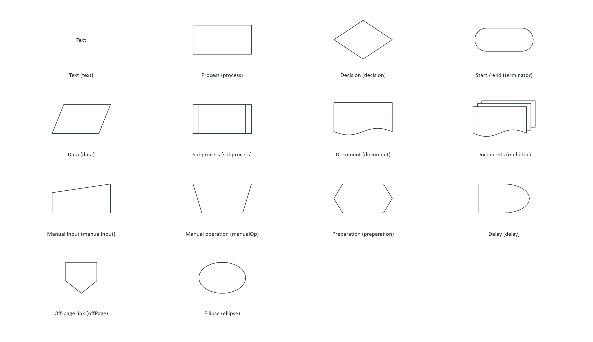

**Database** and **Systems**:

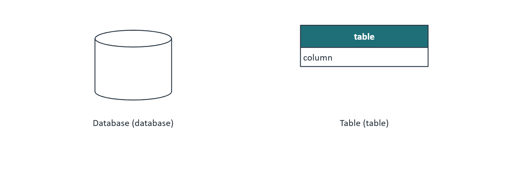

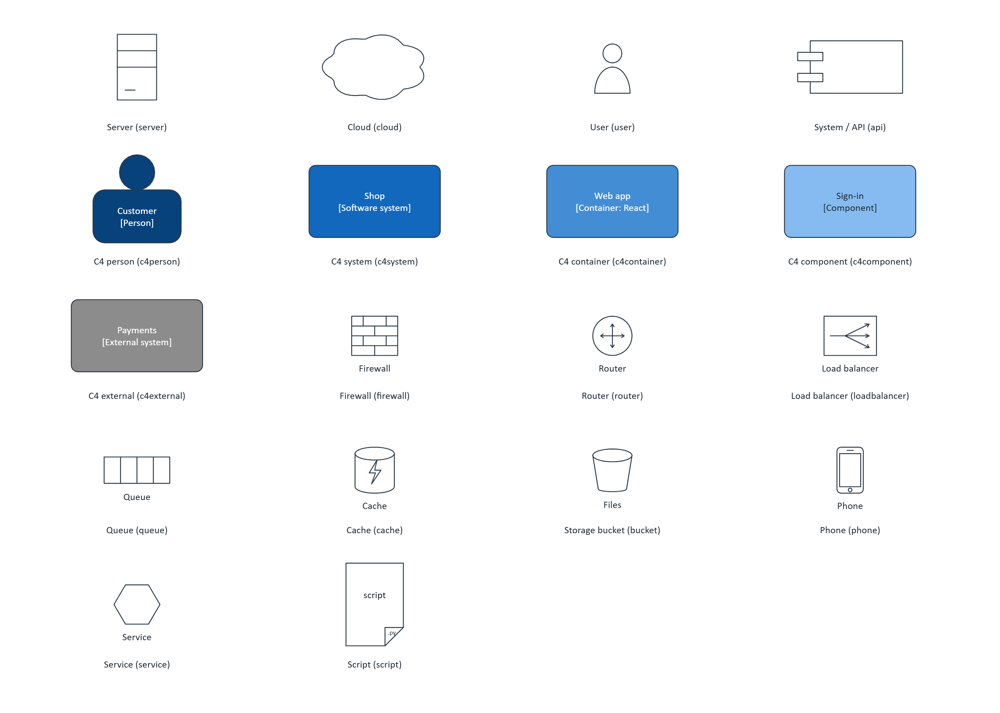

**Containers**: a container is a labelled frame, and a pool holds swimlanes. A shape is inside one when its line
says so, `plan: process "Plan" [in=board]`, and on the page dropping a shape on a container puts it inside, moving the
container moves everything in it, and dragging a shape off takes it out. A pool from the palette comes with two lanes;
drop more on it. [More detail](docs/flow-language.md#containers).

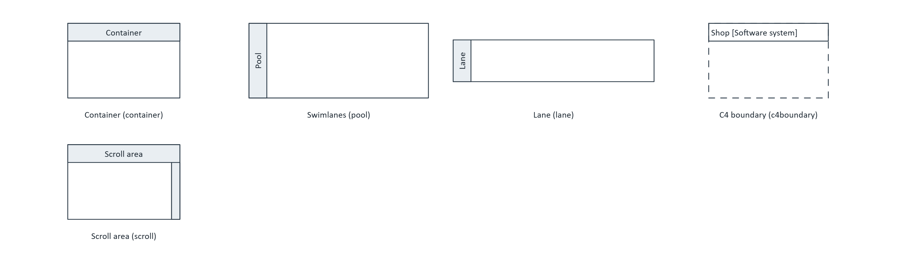

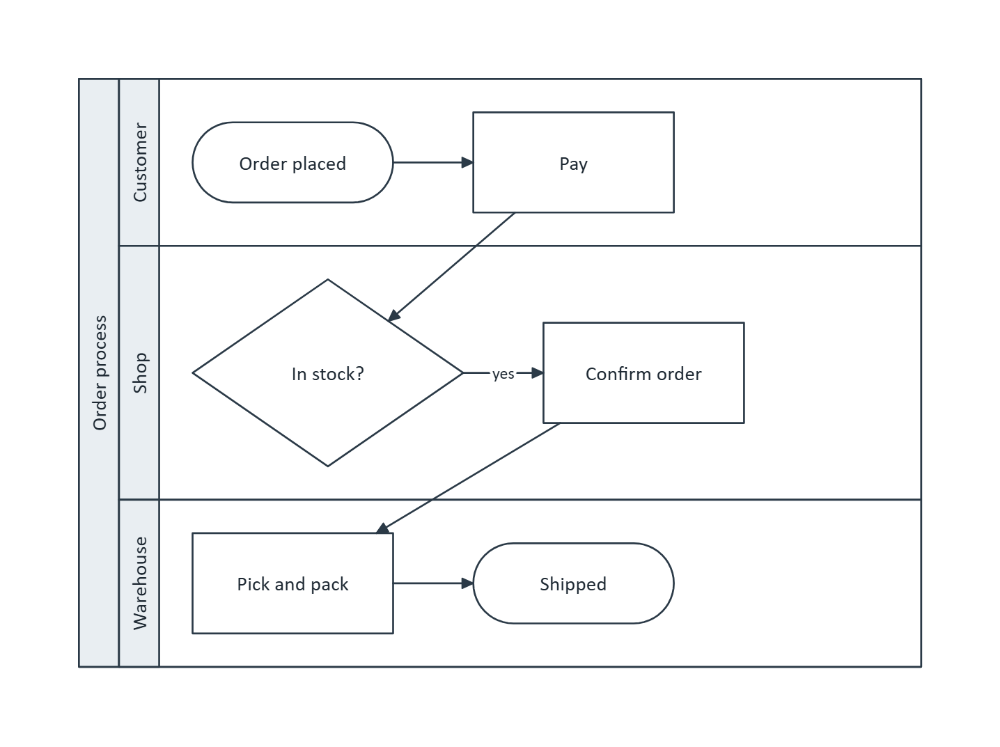 ([source](docs/diagrams/swimlanes.flow))

A **flexi container** lines up what's in it itself, in the order of their lines: `[flow=row]` or `[flow=column]`,
with `gap=` and `align=`. Dragging a card to a new spot reorders the lines. A row of columns makes a kanban board
([source](docs/diagrams/kanban.flow), [more detail](docs/flow-language.md#flexi-containers)):

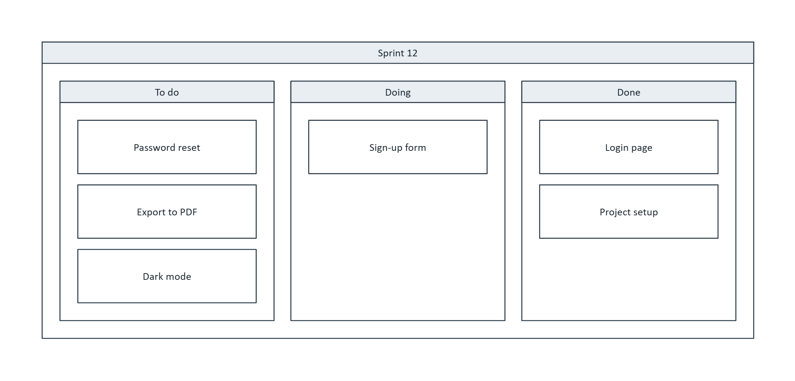

A **scroll area** keeps its size and cuts off what doesn't fit, with a scrollbar whose thumb shows how much does
([source](docs/diagrams/scroll-area.flow), [more detail](docs/flow-language.md#scroll-areas)):

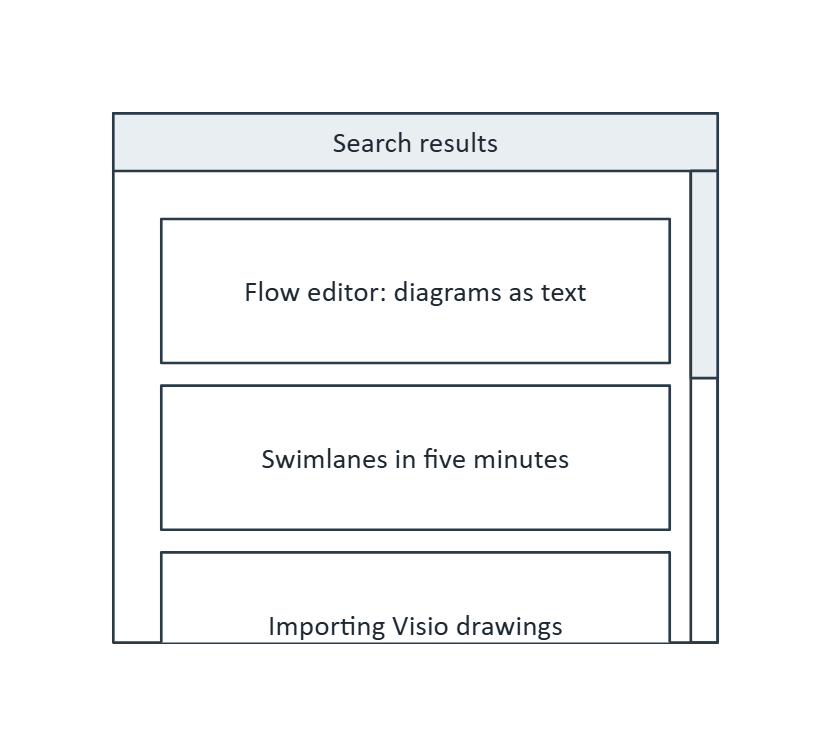

**UI wireframe:**

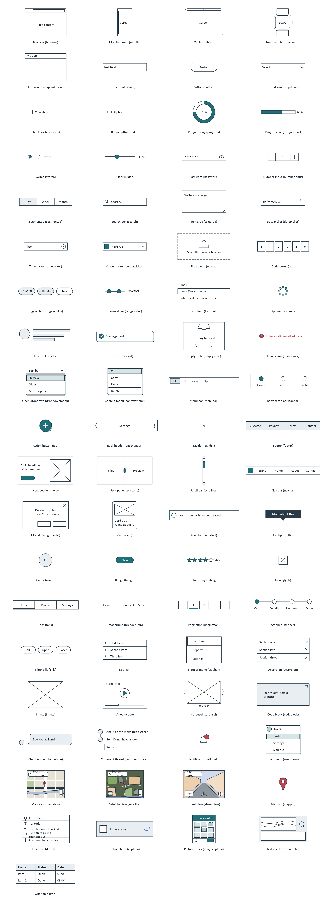

The UI wireframe shapes include device frames (browser, mobile, tablet, smartwatch and desktop app window), form
inputs (field, password, number input, search box, text area, dropdown, date
and time pickers, colour picker, file upload, one-time code boxes, form field with its name and a message, checkbox,
radio button, switch, segmented control, toggle chips, slider and range slider), page pieces (nav bar, tabs, breadcrumb,
pagination, stepper, sidebar menu, list, accordion, open dropdown menu, context menu, menu bar, bottom tab bar, back
header, floating action button, divider, footer, hero section, split pane, scroll bar,
filter pills, modal dialog, card, alert banner, toast, inline error, empty state, spinner, skeleton loader, tooltip,
avatar, badge, star rating, icon placeholder), a progress
ring and bar, an image, a video player (its play button pulses when you point at it), an image carousel, a code block,
a chat bubble, a comment thread, a notification bell (the count in its label goes in the badge), an open user menu, map
screens (a map view, satellite view and street view, a map pin and a directions panel), robot checks (CAPTCHAs: a box
to tick, a picture grid and a code to type) and a grid table, and there are charts for dashboards:

- Shapes with several parts take them in one label, separated by `|`: `t1: tabs "Home | Profile | Settings"`. Each
  part gets its own slot; the first is the current one (the open tab, the current step, the current page).
- A checkbox is ticked, a radio button selected and a switch turned on with the On box in the properties panel or
  `[state=on]` in the text. A slider reads a percentage from its label like the progress bar, and a star rating a
  score: `r1: rating "4/5"`. A range slider reads two: `r2: rangeslider "20–70%"`.
- Toggle chips are on when their name starts with a tick: `c1: togglechips "✓ Wi-Fi | Parking | ✓ Pool"`. A form
  field takes its name, what's typed and a message under it: `f1: formfield "Email | sam@example.com | Required"`.
- An open dropdown menu takes the field, then its options: `d1: dropdownmenu "Sort by | Newest | Oldest"`, the first
  option lit. A context menu lights its first command and sets the last apart with a line.

- A **progress ring** fills to the percentage in its label: `p1: progress "40%"`. A label without a percentage shows
  an empty ring.
- A **progress bar** works the same way as the ring: `b1: progressbar "60%"`. A **switch** is off until it is
  turned on, with the On box in the properties panel or `[state=on]` in the text: `s1: switch "Alerts" [state=on]`.
- A **chat bubble** is a message from someone else, their avatar at the left; `[side=right]` mirrors it for one from
  you, so a conversation alternates: `m2: chatbubble "On my way" [side=right]`.
- The **BI / dashboards** group has bar, horizontal bar, stacked and 100% stacked bar (upright and horizontal),
  histogram, waterfall, funnel, line, area, stacked and 100% stacked area, radar (line and area), polar (rose), spiral,
  pie, donut, scatter, bubble and candlestick charts, a box plot, a heatmap, a Gantt chart, a treemap, a word cloud, a
  Sankey, a chord diagram, a tile map (choropleth), a world map, a country map and a route map, plus a sparkline, a
  bullet chart, a
  gauge, a KPI card and a legend (a column, or a row to go under a chart). A chart draws sample numbers until you give
  it your own, either in the Values box in
  the
  properties panel or in braces in the text: `sales: bar "Monthly sales" { 3, 5, 2, 7 }`. Values are numbers of 0 or
  more. Pie slices, donut slices, funnel bands and polar wedges each take a colour of their own, the first being the
  chart's fill (`[fill=]`); a spiral's parts are alternately filled and left white. Visio files keep the one fill.
    - **Several series:** a row of values per series, rows separated by `;`, each row the same length:
      `sales: bar "By region" { 3, 5, 2; 4, 1, 6 }` draws the series side by side, a line chart draws a line each, an
      area or radar chart overlaps them (the biggest at the back, each outlined in its colour on top), and
      `stackedbar`, `stackedhbar` and `stackedarea` stack them (`percentbar`, `percenthbar` and `percentarea` make
      every category the whole). Each series takes a colour of its own, the first being the chart's fill (a line
      chart's first line keeps its line colour). The other charts show one series.
  - **Your own colours:** `[colours=#AA3377,#228833,#4477AA]` on a chart or a legend colours its series in order,
    the first replacing the fill (and a line chart's first line); series past the list keep the built-in colours.
    Give a chart and its legend the same list and they match. Or pick them in the properties panel: a selected
    chart or legend has a colour picker per series (a pie, a slice each), and Default colours clears the list. No spaces
    between them, or quote the list:
    `[colours="#AA3377 #228833"]`, because a `#` after a space starts a comment.
      - Scatter charts take `x, y` pairs, bubble charts `x, y, size` threes, candlestick charts `open, high, low, close`
        fours and box plots `min, q1, median, q3, max` fives, separated by `;`: `s1: scatter "Height" { 1, 2; 3, 5 }`.
        Rising candles are filled, falling ones outlined. A box plot's five numbers go from smallest to largest.
        A Gantt chart takes `start, length` pairs, a bar per task from the top down, each in its own colour, so a
        legend beside it can name the tasks: `plan: gantt "Launch" { 0, 3; 2, 5; 6, 2 }`.
    - A **treemap** takes a value per tile and names them in its label, separated by `|`, in the same order:
      `spend: treemap "Rent | Food | Fun" { 900, 400, 150 }`. Each tile is as big as its share. A **word cloud**
      takes its words and their weights the same way: `w: wordcloud "Fast | Simple | Cheap" { 9, 5, 2 }`.
    - A **Sankey** names its nodes in the label and takes a `from, to, amount` three per flow, from and to being the
      names' places counting from 1: `s: sankey "Visits | Signed up | Left" { 1, 2, 60; 1, 3, 40 }`.
    - A **chord diagram** takes a square table, a row per group of what it sends to each group, the groups named in the
      label: `c: chord "UK | France | Spain" { 0, 5, 3; 4, 0, 1; 2, 1, 0 }`.
    - A **tile map** gives each region named in its label an equal tile, shaded by its value like a heatmap:
      `m: tilemap "North | South | East" { 3, 9, 5 }`.
    - A **world map**, a **country map** and a **route map** draw real outlines: every country but Antarctica; a
      country's regions (the UK's twelve by default: England's nine, Scotland, Wales and Northern Ireland; or France's
      96 mainland departments with `[map=france]`, named by name, number or code: `Gironde`, `69`, `FR-2A`); and an
      area's parts with its motorways (blue) and main A roads (green) over them (Yorkshire's four by default, or a
      North West county's council districts: `[map=lancashire]`, `greatermanchester`, `merseyside`, `cheshire` or
      `cumbria`, also the Map box in the properties panel, which swaps a label still naming all the old map's parts for
      the new one's).
      Name the ones to shade in the label, with a value each, as on a tile map:
      `w: worldmap "France | Brazil | USA" { 3, 9, 5 }`, `u: countrymap "Scotland | Wales | London" { 4, 7, 9 }`,
      `r: routemap "West Yorkshire | North Yorkshire" { 9, 4 }`. A country can be named by its name, its long name or
      its ISO code (`UK`, `GBR`, `United Kingdom`); a UK region by its name, a short name (`Yorkshire`, `NI`) or its
      ITL code (`TLI`); a part of Yorkshire by its name, a short name (`North Yorks`, `Hull`, `Sheffield`) or its code
      (`TLE2`); a district by its name, its code or a main town in it (`St Helens`, `Blackburn`, `Chester`, `Kendal`).
      ONS counts Halton (Widnes and Runcorn) as Merseyside's, so it's on that map rather than Cheshire's. Names on the
      map are in the label's order; one that matches nothing is left out. Small countries are
      small: their names run over their edges. A route map's shading stops short of the full fill, so the roads show.
    - A **heatmap** takes a row of values per row of cells, each row the same length:
      `h1: heatmap "Load by day" { 1, 5, 8; 9, 3, 2 }`. Each cell is shaded from pale (the lowest value) to the chart's
      fill (the highest); `[fill=]` or a colour in the properties panel changes it. Visio files fill every cell the
      same.
    - A **waterfall** starts at its first value and steps up or down by each one after it, so it is the one chart that
      takes values below 0: `w1: waterfall "Profit" { 10, 4, -3, 5 }`. Rises are filled, falls outlined.
    - A **spiral** puts twelve values on each turn, winding outwards, so values a cycle apart sit side by side.
    - A **sparkline** is a small line with no frame and its label beside it: `s1: sparkline "Sales" { 3, 9, 4, 6 }`.
    - A **bullet chart** takes exactly a value and a target: `b1: bullet "Sales vs target" { 60, 80 }`.
    - A **gauge** fills a half dial to the percentage in its label, like the progress ring: `g1: dial "72%"`.
  - A **legend** lists the series' names in its label, separated by `|`, each with a square in that series' colour,
    the first in the shape's fill like a chart's: `l1: legend "North | South | East"`. Put it beside the chart.
    - A KPI card draws the first line of its label as a large figure and the rest as a caption:
      `k1: kpi "£12.4k\nRevenue"`.
- An **image** shape shows a placeholder until it is given a picture. Select it and use Choose picture in the
  properties panel, or drop a PNG, JPEG, GIF, WebP or SVG file straight onto the page to make a new one. The picture
  is kept like a Visio icon, as an `icon` line plus `[icon=name]`. Large pictures are scaled down first (to 1000 px
  on the longest side, and JPEG for photos), so the drawing stays a manageable size. Replacing a picture removes the
  old one's line if nothing else uses it.
- A **grid table** lists its rows separated by `;` and its cells by `,`, with the first row as the header:
  `g1: grid { Name, Email; Ann, ann@example.com; Bob, "" }`. Empty cells are written `""`, and a cell containing
  `,` or `;` is quoted. Add and remove rows and columns in the properties panel. Edit a cell's text on the page like
  any other text. Like a database table, its height comes from its rows, and its width can only be set in the text.
  Text formats that have no grid (Mermaid, DOT and so on) carry it as a label with `|` between cells, which reads
  back as a grid.

**Patterns:** the palette's last group drops a whole piece of a page at once. A pattern is ordinary text, not a shape
of its own: it is added to the current page as a flexi container (`[flow=column]`, `[flow=row]`) with its shapes
inside, so it comes selected and moves as one, each of its shapes has its own line to edit, and one undo takes it all
away again. Ids that are already used on the page get a number (`email_2`). The group is split into five:

- **UI patterns:** login form, sign-up form, settings page, cookie banner, search results, chat, store locator,
  directions, dashboard, customer journey map and kanban board.

  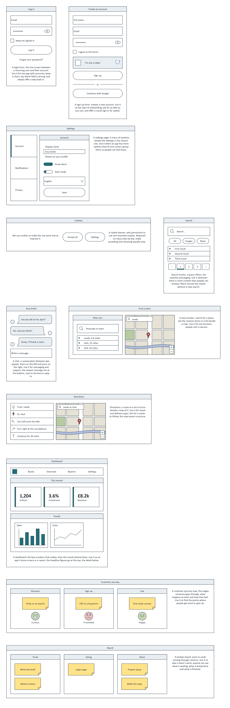

- **Design patterns:** drawn as UML class or sequence diagrams: Singleton, Factory Method, Observer, Strategy,
  Decorator, Adapter, Abstract Factory, Builder, Prototype, Facade, Composite, Proxy, Command, State, Template
  Method, Iterator, Chain of Responsibility, Visitor, Dependency Injection, Flyweight, Mediator, Memento, Bridge,
  Interpreter, Null object and Object pool.

  

- **Architecture:** systems and services as boxes, and request flows as sequence diagrams: Layered architecture,
  Publish/subscribe, CQRS, Microservices, Web app architecture, Circuit breaker, Unit of Work, Model-View-Controller,
  Repository, Client-server request, TCP handshake, OAuth sign-in, Event sourcing, Saga, Strangler fig, Retry with
  backoff, Rate limiter, Webhook, Token refresh and Checkout.

  

- **Algorithms:** data structures and algorithms as flowcharts, node diagrams and UML states: Linear and binary
  search, Bubble, Insertion, Selection, Merge, Quick and Heap sort, Binary search tree, Linked list, Doubly linked
  list, Stack, Queue, Breadth-first and Depth-first search, Dijkstra, Bellman-Ford, A* search, Hash table, Recursion,
  Euclid's algorithm, Binary heap, Trie, LRU cache, Topological sort, Dynamic programming, Two pointers, Sliding
  window, Backtracking, Adjacency matrix and list, Ring buffer, Union-find, KMP string search, Huffman coding, AVL
  rotation, B-tree, Skip list, Bloom filter, Minimum spanning tree, and the worked examples Traffic light and Order
  lifecycle.

  

- **Machine learning:** layers of nodes, flowcharts and worked examples: Neural network, Training loop, Gradient
  descent, Backpropagation, CNN, Transformer block, Decision tree, k-means clustering, Confusion matrix, ML
  pipeline, RNN/LSTM, Autoencoder, Reinforcement learning and Learning curves.

  

**BI / dashboards:**

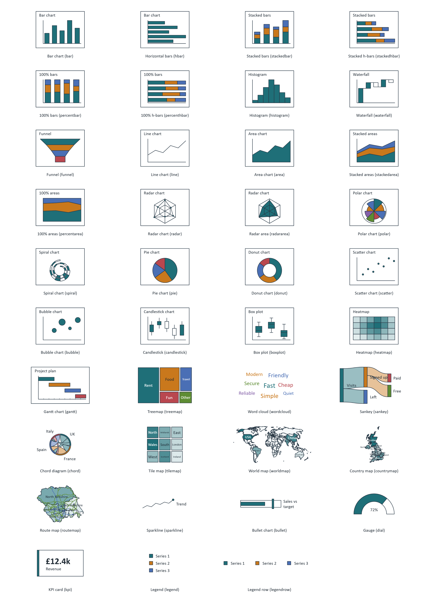

**Planning**: mind map topics, sticky notes, callouts, milestones, timelines, phases, mood faces and person cards.
The topic lines under a central topic are its mind map, each indented under the topic it hangs off, with no
connections to write; the map spreads them out on both sides and moves with the central topic, and **Add topic** in
the properties panel adds one ([source](docs/diagrams/mind-map.flow), [more detail](docs/flow-language.md#mind-maps));
person cards joined by plain connections are laid out top to bottom as an org
chart ([source](docs/diagrams/org-chart.flow)). The Patterns group has a customer journey map and a kanban board.

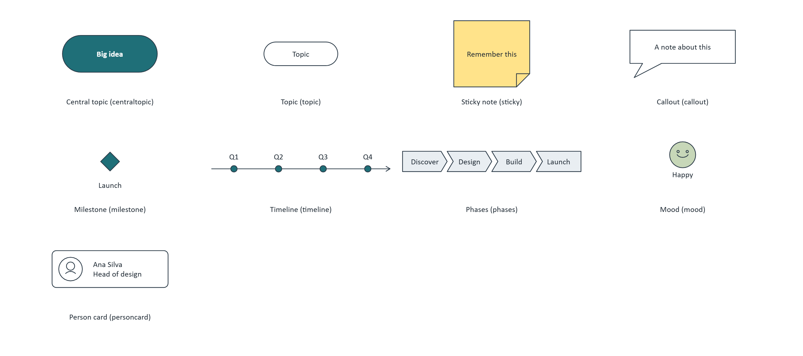

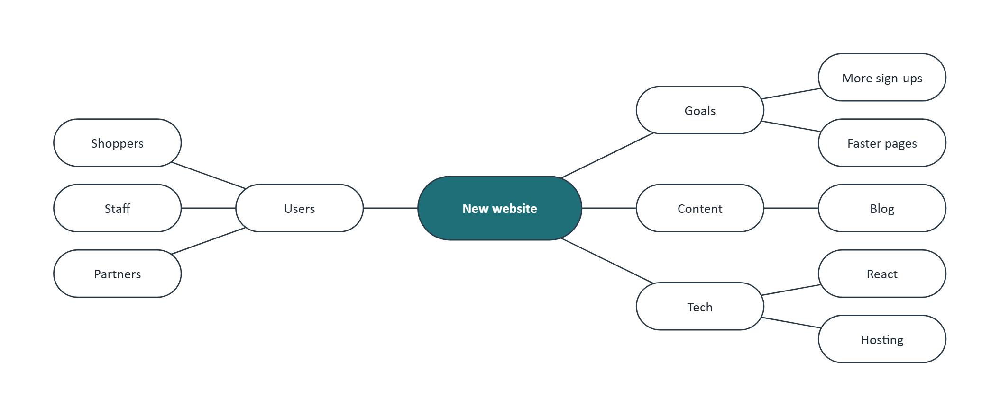

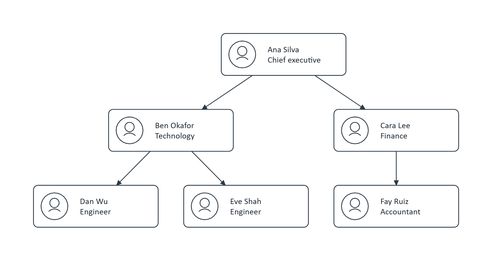

**UML**: a class box (`"Name | attributes | operations"`, one compartment per part), states with initial and final
dots, and sequence lifelines with activation bars. Actor and use case are `user` and `ellipse`.

A **sequence diagram** lays itself out: write the lifelines, then the messages between them in order, and the
lifelines stand side by side in text order with each message a level arrow under the one before, from dashed line to
dashed line, the lifelines as long as they need to be. Nothing about the layout is written back to the text.

```
client: lifeline "Client"
server: lifeline "Server"
client -> server : "GET /orders"
server ..> client : "200 OK"
```

The first lifeline on the page starts the sequence and every later one with no `@` joins it. Give the first an `@` (or
drag it) to move the whole sequence; a later lifeline dragged away snaps back, and one written with an `@` stands on
its own. A message from a lifeline to itself isn't drawn yet (the editor doesn't draw a connection from any shape to
itself), though it stays in the text.

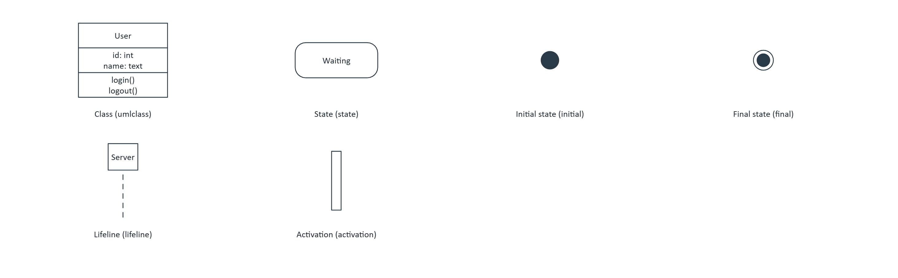

**BPMN**: start, intermediate, end, timer and message events, exclusive, parallel, inclusive and event-based gateways,
tasks (plain, user, service), collapsed subprocesses and data objects. Events, gateways and data objects keep their
size and have their name under them. A message flow is the `-msg->` connection.

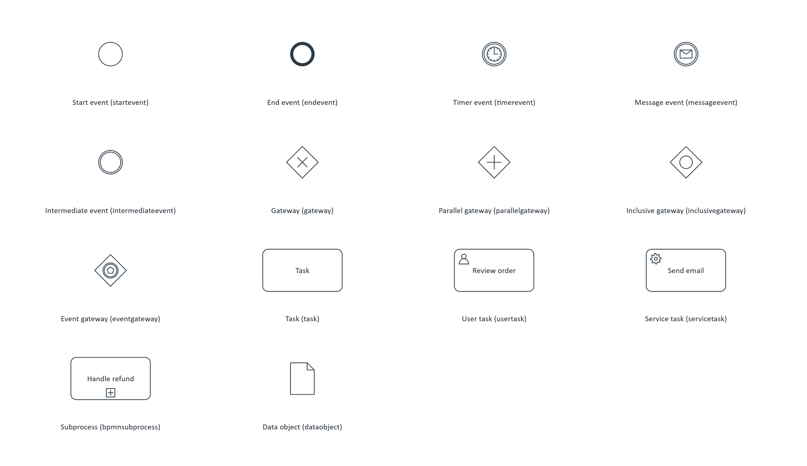

The **Systems** group also has C4 shapes (person, software system, container, component, external system, in the
usual C4 colours, and a dashed C4 boundary to put them in) and network icons: firewall, router, load balancer, queue,
cache,
storage bucket, phone and service.

### Lines and connections

Right-angled lines are edited as in Visio: select one and drag the square handle on any segment sideways; the end
handles re-attach either end. Moving a group of shapes moves the routes between them too; moving or resizing one
end keeps the bends and slides the one next to that end so the line stays square. A line without bends is routed
automatically, around other shapes. A line is drawn just above the later of the two shapes it joins, so it shows over
whatever its ends sit on (a filled panel or frame) but still runs beneath any shape that comes after them in the file.

Every shape has four snap points, at the middle of each side. Dragging a connection's end handle (or drawing a new
one in connect mode) near one sticks the line to that exact point — shown as a small circle, filled in once the
pointer is close enough — instead of the usual automatic glue, which always faces whichever shape is at the other
end. A line glued to a snap point stays on that side of the shape even after the shape is moved or resized. In the
text it is `beginpt=`/`endpt=` (n, e, s, or w). In the text an end can also be part way along a side: `e@0.3` is 0.3
of the way down the right side (down for e and w, left to right for n and s), so several lines can meet one side at
different heights: `a -> b [endpt=w@0.25]`. Where a shape has no outline at that point (a lifeline below its head),
the line ends on the line through the shape's middle.

### Connection types, arrows and the key

To draw a connection, choose **Connect** at the top of the palette and drag from one shape to another; Escape
goes back to selecting. In the text, a connection is the two shape ids with the connection type between them, and
an optional label after a colon: `review -> approve : "if approved"`.

Every connection has a **type**, which decides its line and its ends, and carries a meaning that the page's key
explains. This picture shows every type with what you type to get it, and the page's own key underneath
([source](docs/diagrams/connection-types.flow)):

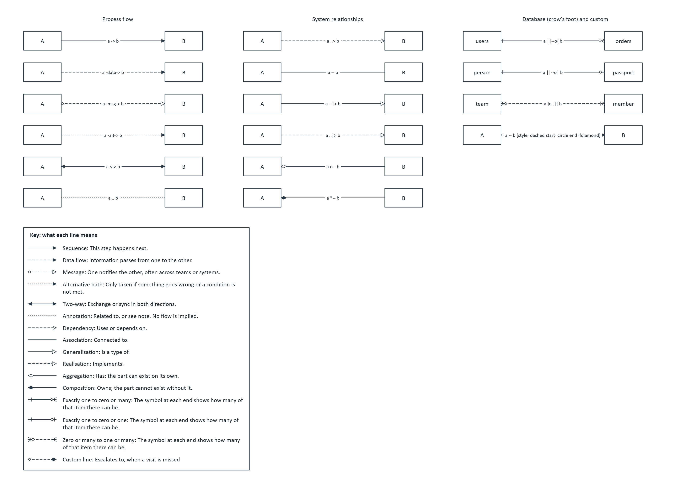

| Type | Type it as | Line | Ends | Means |
|---|---|---|---|---|
| Sequence | `a -> b` | solid | arrow | This step happens next. |
| Data flow | `a -data-> b` | dashed | arrow | Information passes from one to the other. |
| Message | `a -msg-> b` | dashed | circle → hollow triangle | One notifies the other, often across teams or systems. |
| Alternative path | `a -alt-> b` | dotted | arrow | Only taken if something goes wrong or a condition is not met. |
| Two-way | `a <-> b` | solid | arrows at both ends | Exchange or sync in both directions. |
| Annotation | `a .. b` | dotted | none | Related to, or see note. No flow is implied. |
| Dependency | `a ..> b` | dashed | open arrow | Uses or depends on. |
| Association | `a -- b` | solid | none | Connected to. |
| Generalisation | `a --\|> b` | solid | hollow triangle | Is a type of. |
| Realisation | `a ..\|> b` | dashed | hollow triangle | Implements. |
| Aggregation | `a o-- b` | solid | hollow diamond at `a` | Has; the part can exist on its own. |
| Composition | `a *-- b` | solid | filled diamond at `a` | Owns; the part cannot exist without it. |
| Relationship (crow's foot) | `a \|\|--o{ b` | solid (`--`) or dashed (`..`) | how many at each end | Each `a` has zero or many `b`. |
| Custom | `a -- b [style=… start=… end=…]` | your choice | your choice | Your own, from `means=`. |

**Crow's foot ends**, for database diagrams: the left end is written `||` (exactly one), `|o` (zero or one), `}|`
(one or many) or `}o` (zero or many), and the right end `||`, `o|`, `|{` or `o{`, the same symbols facing the other
way. `users ||--o{ orders` reads "each user has zero or many orders; each order belongs to exactly one user", and
the key spells it out in those words.

**Your own line.** Any connection can take its own line and ends in `[ ]`, which makes it a custom line:

- `style=` is `solid`, `dashed` or `dotted`
- `start=` and `end=` are `none`, `arrow` (filled), `open` (open arrow), `triangle` (hollow), `diamond` (hollow),
  `fdiamond` (filled diamond), `circle`, or a crow's foot end: `one`, `zeroOne`, `oneMany`, `zeroMany`
- `means=` is what the key says it means: `a -- b [style=dashed start=circle end=fdiamond means="Escalates to"]`.
  On any other type it replaces the standard meaning
- `stroke=` (line colour) and `text=` (label colour) take a colour like `#1F6F78`; `weight=` is the line thickness
  in points (0.25 to 12) and `size=` the label's text size in points (4 to 96)
- `route=elbow`, `via=` and `beginpt=`/`endpt=` are the route and snap points described above

In the properties panel, a selected connection shows the same choices: its **Connection type**, its route, **Line**,
**Start** and **End**, **Meaning shown in the key**, and **Reverse direction**, which swaps its ends. With nothing
selected, the Page panel's **New connections** box picks the type that Connect draws next; changing a connection's
type also makes it the type for new ones.

**The key.** Add a key to this page (on the Page panel), or a `key "Title"` line in the text, puts a key on the page
that lists every type of connection the page uses, each with a sample of its line and what it means, and keeps
itself up to date as connections change. Drag it like a shape; its place is kept as `key "Title" @ x,y`. The same
button removes it. In text formats that can't draw a line type, the type travels in the label instead
(`Automation (data flow)`), and it reads back as that type when imported.

### The `.flow` language and the text pane

Every drawing is plain text, one statement per line, and **[docs/flow-language.md](docs/flow-language.md)** is the
full reference: every statement, keyword, setting, connection type and alias, the rules for ids, quotes, comments
and units, the error messages, and a grammar summary. In short:

```
flow 1                                              # the header: version 1
page "Orders" size 297x210 direction LR             # a page: name, optional size in mm and layout direction
start: terminator "Order placed" @ 15,20            # a shape: id: type "label" @ x,y (mm from the top left)
check: decision "In stock?" @ 75,15 40x24           # ... with a width and height
pick: process "Pick and pack" [fill=#DCE3EB]        # ... with settings, and placed automatically
sales: bar "Orders per day" { 3, 5, 2, 7 }          # { } holds a chart's values, a table's columns, a grid's cells
start -> check                                      # a connection: from TYPE to
check -alt-> wait [weight=1.5] : "no"               # ... with settings, then a label
customers ||--o{ orders                             # crow's foot: one customer, zero or many orders
key "Key" @ 145,95                                  # the key that explains the lines
```

The [example in the reference](docs/flow-language.md#an-example) shows a whole file next to the picture it makes.

**The text pane** (Text on the edge of the page, or Ctrl+E) shows the page as `.flow`, live in both directions:
typing redraws the page as soon as the whole text reads cleanly, and editing the page rewrites only the lines that
changed, keeping your comments and order. Put the caret on a line to select that shape or connection on the page;
select something on the page to highlight its line. A line with a mistake is marked in the margin, with what's
wrong underneath, and the page keeps its last good version until it's fixed. The box at the top switches the pane
to Mermaid, PlantUML or DOT, which you edit and then Apply.

**IntelliSense** suggests what can come next as you type, based on where you are in the line:

- at the start of a line, `page`, `key`, `icon` and this page's shape ids
- after `id:`, every shape type with its palette name, and the aliases
- after an id and a space, every connection type with its meaning
- after a connection, the shapes on the page to connect to
- inside `[ ]`, the settings the line doesn't have yet; after `name=`, that setting's values (the Routes palette
  for colours)
- on a page line, `size` and `direction`, then common page sizes and the four directions

It ranks words that start with what you've typed above ones that only contain it. Accepting a shape type puts the
caret between new quotes ready for the label; accepting a connection type or a setting opens the next list
straight away. Up and Down move, Enter or Tab accepts, Escape closes, and Ctrl+Space opens it anywhere. It stays
quiet inside quotes and comments. [More detail](docs/flow-language.md#intellisense).

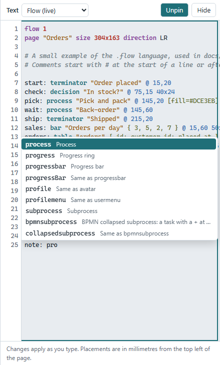
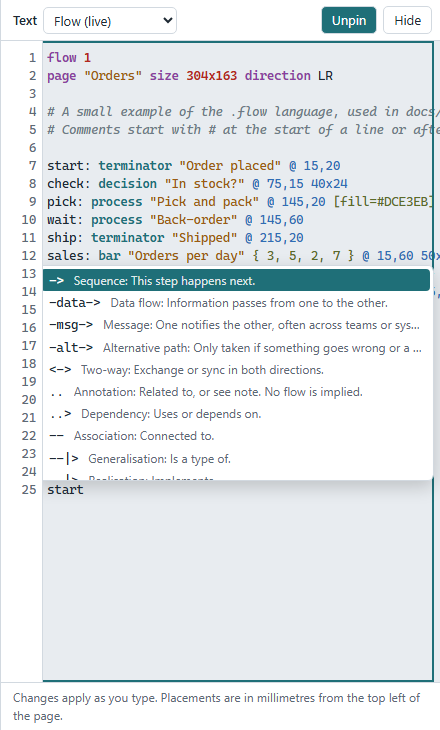

### Text sizes

Text sizes come across from Visio (`size=8` in the text, in points) and can be set for any selection in the
properties panel. Text is measured as drawn, so words are only split when a single word is wider than its shape.

### Pages

With nothing selected, the Page panel renames the page, sets an explicit width and height (in the text, `size
900x700`), offers presets for A1 to A5 and US Letter in both orientations, and Fit page to content sets that size
to whatever is actually on the page, with the same margin new content is placed with. Delete this page removes
the page outright (not just its content); the last remaining page cannot be deleted.

A page's tab, at the bottom, offers the same two things directly: double-click it to rename it in place, or use
its own close button to delete it (disabled, like Delete this page, on the last remaining page). More tabs than
fit in the bar just scroll.

Choosing a size smaller than what is already on the page never moves, resizes, or deletes anything: the page
itself stays at the size chosen, and whatever reaches past it is shown on a light grey background rather than
being forced to fit. A page with no explicit size still grows with its content, as a floor of A4 landscape. PNG
and PDF exports, and the page size written to a draw.io export, crop to the page's own size — the part shown in
grey will not be in them. Dragging a shape past the edge of a page with no explicit size still grows that page,
as it always has; dragging past the edge of an explicitly sized page just shows the shape in the grey area, the
same as anything else past that page.

### Presenting step by step

An `@animation` block at the bottom of a `.flow` file lists steps, each restating shapes with `$id` in normal shape
syntax: `$pay @ 80,60 [fill=#C8E6C9]` moves Pay and turns it green, `-$ship` hides Ship, `+$ship` brings it back,
and `+retry: process "Retry"` adds a shape only the animation has. Anything a step leaves out carries over from the
step before. **Present** plays the steps full screen like a slide deck: **→**, **Space** or a click for the next
step, **←** for back, **Esc** to leave. Shapes slide to their new places and crossfade when they change how they
look. The drawing itself is never changed: leaving shows it exactly as it was, and exports leave the block out. See
[Animations](docs/flow-language.md#animations) for the whole syntax.

## Diagrams

`examples/` holds generic `.flow` diagrams, unrelated to any particular project, showing what the format and the
shapes look like. `build-pipeline.flow` is a small CI-build process with a decision and a loop; press **Present**
to step through it stage by stage (see [Presenting step by step](#presenting-step-by-step)).
`order-flow-animated.flow` is an order going through a flowchart in five steps, the same way.

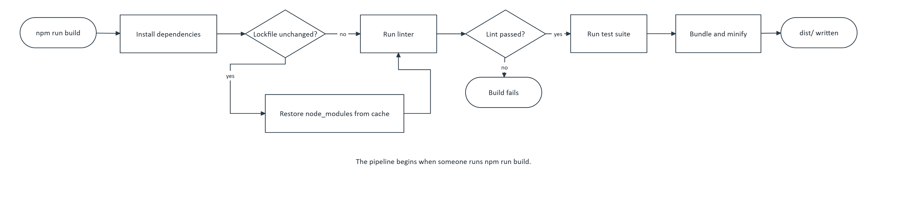

## How DesignRoutes works

`docs/diagrams/` holds `.flow` diagrams of DesignRoutes's own architecture, each exported to PNG with the editor's
own PNG export. Open the `.flow` source in DesignRoutes to explore or edit it.

**The plan** ([docs/app-plan.md](docs/app-plan.md)) — DesignRoutes planned as if from scratch: what it's for, its
principles, every region of the screen, the main flows, the architecture the code is moving towards, its known
limits, and a checklist for moving the rest of the UI into components. Its wireframes are drawn in DesignRoutes
itself ([source](docs/diagrams/app-wireframe.flow), three pages: the editor, dialogs and tour, and selection).


**Module architecture** ([source](docs/diagrams/module-architecture.flow)) — how the React components and the
modules listed under Developing below relate to one another. React draws the page; most components are still
markup that the `src/js` modules wire up by id, while `Palette.tsx` and `Stage.tsx` own their handlers.
`document.ts` is the hub that editing, the palette, the `.flow` text pipeline, the canvas renderer and the format
importers/exporters all commit through.


**Palette to shape** ([source](docs/diagrams/palette-to-shape.flow)) — how a shape gets from its definition to
the canvas. Each shape is one `ShapeDef` in a group file in `src/shapes/`, palette entry included; `registry.ts`
builds both `SHAPES` (to draw it) and `PALETTE` (to list it) from those. Clicking or dragging its button calls
`placeShape`, which adds the shape through `addShape` and `buildShape`.

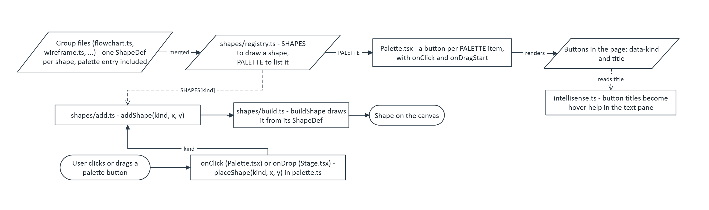

**Import/export data flow** ([source](docs/diagrams/import-export-flow.flow)) — what happens to a drawing on the
way in (Mermaid/PlantUML/DOT/draw.io text or a Visio package, auto-laid-out if it carries no positions) and the
way out (back to those formats, or a one-way PNG/PDF snapshot that cannot be imported again).

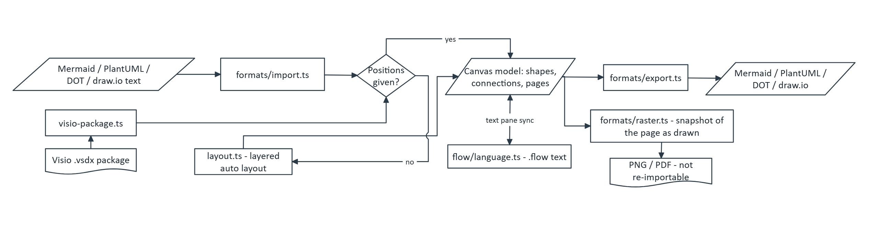

**Build and deploy pipeline** ([source](docs/diagrams/build-deploy-pipeline.flow)) — from `src/` through
`npm run build` to the single-file `dist/DesignRoutes-editor.html`, opened straight from disk or served by any app
that embeds it; plus where `npm run dev` and the Playwright suite sit.

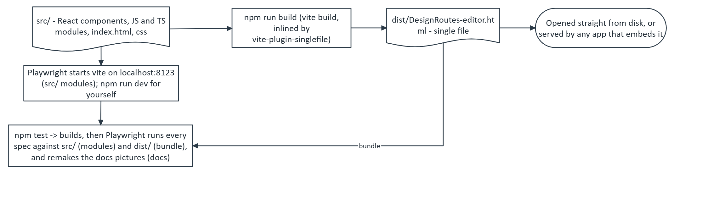

**Text pane / canvas sync** ([source](docs/diagrams/text-canvas-sync.flow)) — edits typed in the text pane and
edits dragged on the canvas both end up going through the same `document.ts` commit, which is why undo/redo and
rebuild stay consistent regardless of which side you worked on.

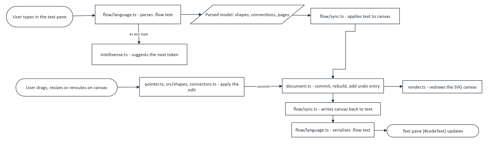

**CI pipeline** ([source](docs/diagrams/ci-pipeline.flow)) — what `.github/workflows/tests.yml` runs on every push
or pull request to `main`: installs Chromium, runs the full Playwright suite against both
the `modules` and `bundle` projects, type-checks, and uploads the HTML report as a workflow artifact regardless of
the result.

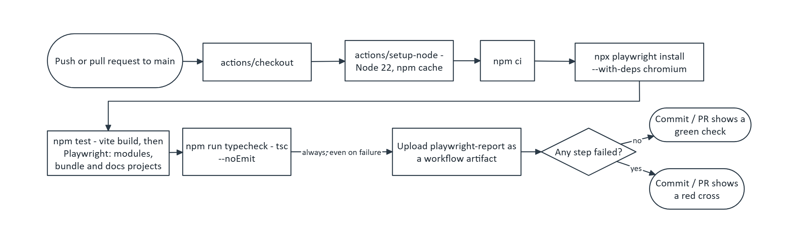

## Developing

The source is a React app around an engine of plain modules. React draws the page; the modules in `src/js` (moving to
`src/engine` one file at a time, as each becomes TypeScript) do the work, and most of them still wire their part
of the page up by `id` from an `init()`. Palette and Stage already own their behaviour, and
[docs/app-plan.md](docs/app-plan.md#migration-checklist) lists what's left to move.

```
src/
  index.html             the page React draws into
  main.tsx, App.tsx      React entry: draws the components, then loads js/main.ts
  components/            one component per region of the screen (Toolbar, Palette, Stage, Props, the text pane,
                         page tabs, dialogs, tour)
  css/flow-editor.css    styles
  js/main.ts             runs each module's init() in order (core.ts first), then opens a blank drawing
  js/core.ts             shared state (S), constants and small DOM/XML helpers
  js/visio-package.ts    reading Visio packages; shape -> master -> style inheritance
  js/geometry.ts         ShapeSheet geometry and transforms
  js/render.ts           drawing shapes to SVG, selection overlay, zoom and pan
  js/connectors.ts       connector routing and glue
  shapes/                shape library (TypeScript): one file per palette group, each ShapeDef carrying its
                         palette entry; registry.ts builds SHAPES and PALETTE from them; building, tables, grids
                         and adding shapes; index.ts is what everything else imports
  js/selection.ts        multi-selection, delete, move, duplicate
  js/pointer.ts          hit testing, hover, marquee, drag, resize, connect
  js/text-editor.ts      in-place text editing
  js/properties.ts       properties panel
  js/formats/export.ts   graph model and exporters (Mermaid, PlantUML, DOT, draw.io)
  js/formats/import.ts   importers for the same formats
  js/formats/raster.ts   PNG and PDF export: a snapshot of the page as drawn, with a hand-built PDF wrapper
  js/layout.ts           automatic layered layout for imports without positions
  js/dialogs.ts          import and export dialogs
  js/flow/model.ts       connection types and the user-defined cells the model is stored in
  js/flow/language.ts    the .flow language parser and writer
  js/flow/sync.ts        text to canvas and canvas to text
  js/document.ts         document state, undo/redo and rebuild
  js/visio-io.ts         Visio import, opening and saving files
  js/text-pane.ts        the text pane
  js/hot-keys.ts          toolbar buttons and keyboard shortcuts
  js/tutorial.ts         the guided tour
  js/intellisense.ts     suggestions as you type in the text pane
  engine/                engine files already converted to TypeScript and moved out of js/:
  engine/palette.ts      what the palette does: placing shapes, and the select/connect tool (a small store)
  engine/connection-props.ts
                         connection settings in the properties panel
```

Modules only declare things when imported. Anything that touches the page (event listeners, DOM lookups) is in the module's `init()`, and `main.ts` calls those in a fixed order.

Browsers do not load ES modules from `file://`, so serve `src/` while developing:

```shell
npm install
npm run dev        # http://localhost:5173, reloads on save
```

After changing anything in `src/`, rebuild the single-file copy and commit it with the source:

```shell
npm run build      # writes dist/DesignRoutes-editor.html
```

### Desktop app (Tauri)

`src-tauri/` wraps the same page in a native window with [Tauri](https://tauri.app). It needs Rust (rustup, the
`stable-msvc` toolchain) and, on Windows, the Visual Studio C++ build tools with a Windows SDK.

```shell
npm run tauri dev                          # desktop window on the Vite dev server, reloads on save
npm run tauri build -- --debug --no-bundle # src-tauri/target/debug/designroutes.exe, no installer
npm run tauri build                        # release build and installers
```

The first build compiles Tauri itself and takes a few minutes; later ones are quick.

#### Making a release

1. Bump `version` in `src-tauri/tauri.conf.json` (and `src-tauri/Cargo.toml`), so an installer replaces the
   previous one cleanly.
2. `npm run tauri build`. The first time, it downloads the installer tools (WiX for the MSI, NSIS for the setup
   `.exe`). It writes, under `src-tauri/target/release/`:

   | File | What it is |
   |---|---|
   | `bundle/nsis/DesignRoutes_<version>_x64-setup.exe` | The installer to share (about 2 MB): Start menu entry and uninstaller. |
   | `bundle/msi/DesignRoutes_<version>_x64_en-US.msi` | The same as an MSI, for IT-managed machines. |
   | `designroutes.exe` | The bare program. Runs without installing; the page is built into it. |

3. Share the setup `.exe`, ideally as a GitHub Release: Releases → *Draft a new release* → tag `v<version>` →
   attach the file. Email often blocks `.exe` attachments.

The app isn't code-signed, so Windows SmartScreen shows "Windows protected your PC" on first run: **More info →
Run anyway**. It needs WebView2, which current Windows 10 and 11 already have. Mac and Linux builds have to be made
on those systems (for example in CI with `tauri-action`).

Every picture in the docs is made by the editor itself, and `npm test` remakes them all (see Testing): the shape
gallery (regenerated from the palette, so a new shape appears in it automatically), a PNG of every `.flow` in
`docs/diagrams/` and `examples/` (one per page, using the editor's own PNG export), and the screenshot at the top of
this file. Before exporting, it fits each page to its content and saves that size into the `.flow` file (the
`size` on its `page` line), so a diagram opens in the editor exactly as its picture shows it. After a test run, commit any pictures that changed along with the change that caused them.

## Testing

End-to-end tests use Playwright and run every spec twice: against the modules in `src/` (served by Vite's
dev server) and against the single-file `dist/DesignRoutes-editor.html` opened from disk. A third project, `docs`
(`tests/docs/images.spec.js`), rebuilds the documentation's pictures with the app, and fails if any diagram in
`docs/diagrams/` or `examples/` has an error, naming the file and line. CI runs it too, as that check; the pictures
it makes there are thrown away, since GitHub's Linux machines don't have the Calibri font the diagrams use. JSZip is bundled
rather than loaded from a CDN, so the tests and the built file work offline.

```shell
npm install
npx playwright install chromium   # first time only
npm test                          # builds, then runs tests/e2e
npm run test:ui                   # Playwright's interactive runner
npx playwright test --project=docs # only rebuild the documentation pictures
```

`tests/e2e/fixtures.js` holds a small page object (`FlowApp`) that drives the editor through its UI only:
find shapes by their text, click, drag, read the selection title. Specs fail on any uncaught page error.
`tests/fixtures/visio-flowchart.vsdx` is a real Visio flowchart with every label replaced by a placeholder, the
author details removed, and its icon-stencil artwork replaced with plain shapes drawn for this project.

## License

[MIT](LICENSE.md). The editor and the skill bundle other people's code and map data; their licences and credits
are in [THIRD-PARTY-NOTICES.md](THIRD-PARTY-NOTICES.md), which the editor shows under **Credits** and the build copies into the built page (and the skill
build into the skill's `NOTICES.md`).

### Map data

The maps carry outline data made by `scripts/build-maps.mjs` (`src/shapes/maps/`; the script says how to remake it):

- World countries: [Natural Earth](https://www.naturalearthdata.com/), 1:110m admin 0 countries, public domain.
- France's departments: Natural Earth, 1:10m admin 1 states and provinces, public domain.
- UK regions: Source: Office for National Statistics licensed under the
  [Open Government Licence v.3.0](https://www.nationalarchives.gov.uk/doc/open-government-licence/version/3/).
  Contains OS data © Crown copyright and database right 2025. (International Territorial Level 1, January 2025,
  ultra generalised clipped boundaries.)
- Route maps' areas and roads: Source: Office for National Statistics licensed under the Open Government Licence
  v.3.0 (International Territorial Level 2, January 2025, and Local Authority Districts, May 2025, generalised clipped
  boundaries). Contains OS data © Crown
  copyright and database right 2025 and 2026 (OS Open Roads, under the
  [OS OpenData licence](https://www.ordnancesurvey.co.uk/customers/os-open-data-licence)).
