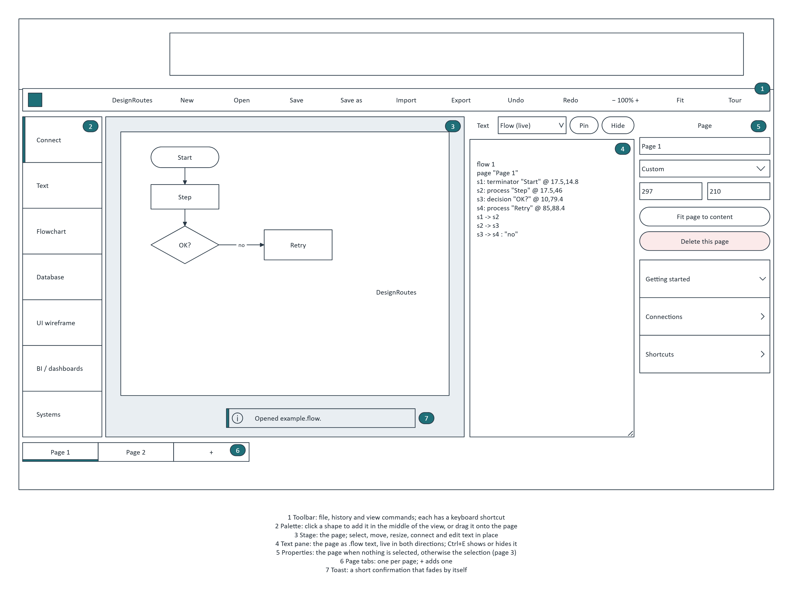
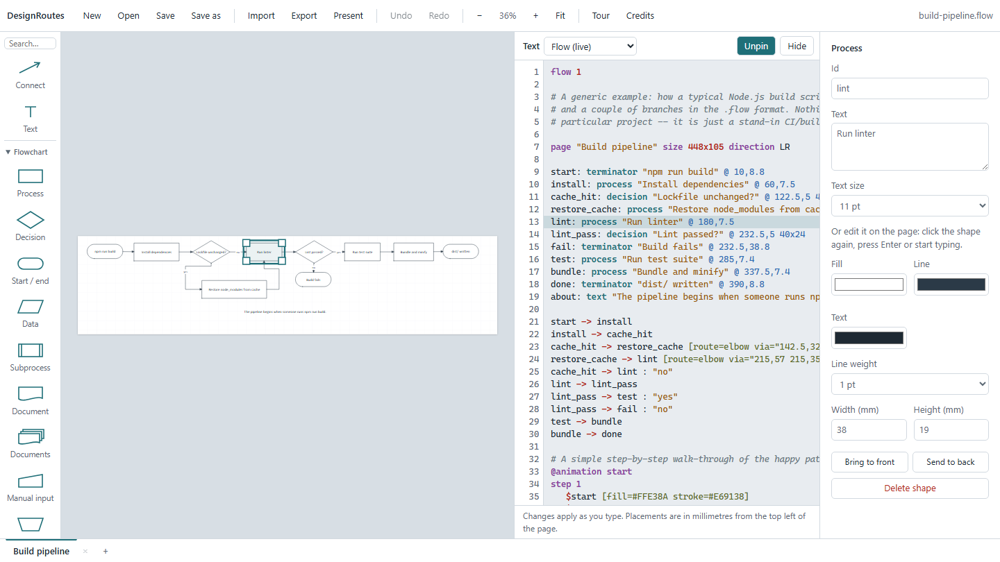
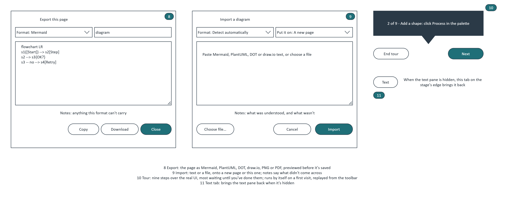
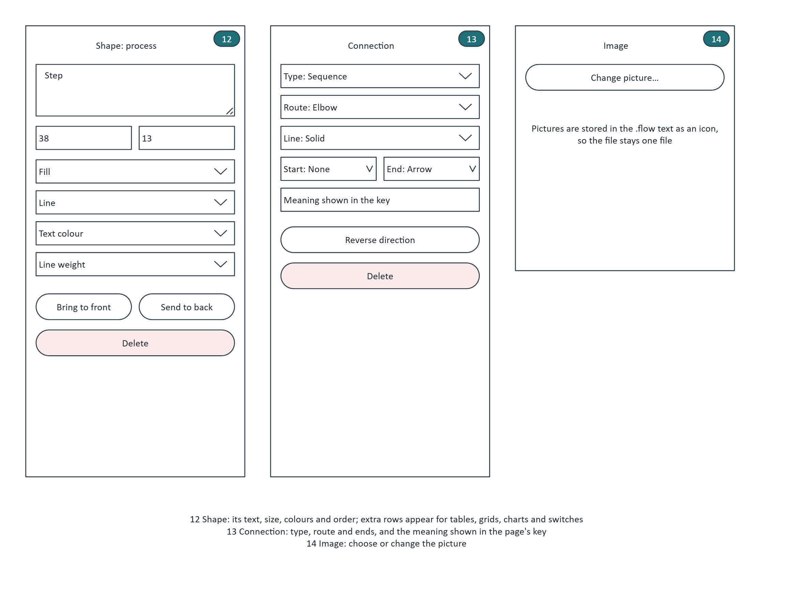
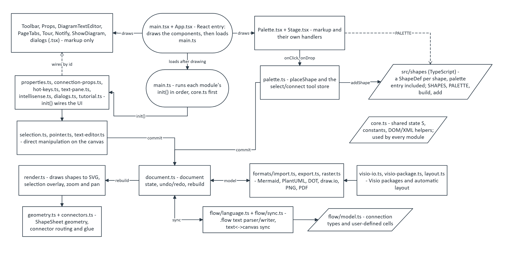

# DesignRoutes: the plan

Written as if planning the editor from scratch, using what building it has taught us. It describes where the code
is heading as much as where it is: the [Migration checklist](#migration-checklist) at the end says which parts are
there yet. The wireframes are drawn in DesignRoutes itself: open
[`diagrams/app-wireframe.flow`](diagrams/app-wireframe.flow) to see or change them. The numbers in the wireframes
match the numbered regions below.

## What we're building

A diagram editor where **the picture and a short text description are the same document**. You can draw on the
page or type in the text pane, and the other side keeps up as you go. It runs from **one HTML file**, needs no server
and works offline. It reads and writes the formats people already have: Visio drawings, and Mermaid, PlantUML,
Graphviz DOT and draw.io text.

### Who it's for

- People who **think in boxes and arrows**: flowcharts, data models, system maps, wireframes and dashboards. They
  want to drag things around.
- People who **think in text**: they want to type `a -> b`, diff it, review it and keep it in git.
- **Both, on the same diagram.** Someone sketches on the page, and someone else tidies the text in a pull request.

### Goals

- Text and canvas always agree. Neither side is a one-off import of the other.
- One file to ship. Opening `DesignRoutes-editor.html` from disk is a full install.
- Formats in and out without lock-in, and a clear note whenever something can't come across.
- A new user can draw, connect and save inside a minute, with a tour that waits for them to do each step.

### Non-goals

- Real-time collaboration. Sharing goes through the text, and through git.
- A cloud account or storage.
- Pixel-perfect Visio fidelity. We keep what a diagram means, and say what we drop.

## Principles

1. **The text is the source of truth.** The canvas is rebuilt from the `.flow` text on every change. A canvas edit
   writes the text back, and only the lines it changed.
2. **A shape is data, not code.** Each shape is one `ShapeDef` holding its size, outline, default text and palette
   entry. One renderer draws them all, and adding a shape means adding one entry. The
   [shape gallery](diagrams/shape-gallery.flow) is generated from those entries, so it always shows every shape
   (pictures in the README's Shapes section).
3. **A component owns its piece of the screen.** A React component holds its markup *and* its behaviour. Nobody
   else reaches into it by `id`.
4. **The canvas is an engine, not a component tree.** Hundreds of SVG elements, dragged at 60 frames a second, are
   drawn by hand. React owns the element they're drawn into and leaves the inside alone.
5. **Every action has a keyboard shortcut**, and the Properties panel lists them.
6. **Say what was lost.** Import and export always report what a format couldn't carry.

## Screens

### 1 Editor

And as built, with the text pane pinned and a shape selected:

| # | Region     | What it does                                                                                                                                          | Component                                              |
|---|------------|-------------------------------------------------------------------------------------------------------------------------------------------------------|--------------------------------------------------------|
| 1 | Toolbar    | File (New, Open, Save, Save as), Import and Export, Undo and Redo, zoom, Fit, Tour. The file name sits at the right.                                  | `Toolbar.tsx`                                          |
| 2 | Palette    | Connect tool, Text, then one collapsible group per shape file. Click a shape to add it in the middle of the view, or drag it onto the page.           | `Palette.tsx`                                          |
| 3 | Stage      | The page on its grid. Select, marquee-select, move, resize, connect, and edit text in place. Drop a picture or a file onto it.                        | `Stage.tsx` (with `render.ts` and `pointer.ts` inside) |
| 4 | Text pane  | The page as text, live in both directions, with suggestions as you type. Can also show Mermaid, PlantUML or DOT. Pin keeps it open beside the canvas. | `DiagramTextEditor.tsx`                                |
| 5 | Properties | The page when nothing is selected (name, size, connections, key, shortcuts). Otherwise the selection (screen 3).                                      | `Props.tsx`                                            |
| 6 | Page tabs  | One tab per page; double-click a tab to rename it in place, its own close button to delete it (disabled on the last page); + adds a page. Overspill scrolls. | `PageTabs.tsx`                                         |
| 7 | Toast      | A short confirmation that fades by itself.                                                                                                            | `Notify.tsx`                                           |

### 2 Dialogs and tour

| # | Region | What it does | Component |
|---|---|---|---|
| 8 | Export | The page as Mermaid, PlantUML, DOT, draw.io, PNG or PDF. Text formats are previewed, with notes on anything that can't be carried, then copied or downloaded. | `ExportDialog.tsx` |
| 9 | Import | Paste text or choose a file, detected automatically. It goes onto a new page, replaces this page, or sits beside what's already there. | `ImportDialog.tsx` |
| 10 | Tour | Nine steps over the real UI. Most wait until you've done them (add a shape, edit it, connect two). It starts by itself on a first visit and can be replayed from the toolbar. | `Tour.tsx` |
| 11 | Text tab | Brings the text pane back when it's hidden. | `ShowDiagram.tsx` |

### 3 Selection

| # | Region | What it does |
|---|---|---|
| 12 | Shape | Its text, size, fill, line, text colour, weight and stacking order. Extra rows appear only where they mean something: rows and columns for tables and grids, values for charts, on/off for switches. |
| 13 | Connection | Its type, route (straight or elbow), line style, the ends, the meaning shown in the page's key, and reverse. |
| 14 | Image | Choose or change the picture. It's stored in the `.flow` text as an icon, so the file stays one file. |

Shape is `ShapeProps.tsx`, Connection is `ConnectionProps.tsx`; `Props.tsx` just dispatches to whichever of
`PageProps`/`MultiProps`/`ShapeProps`/`ConnectionProps` owns the current selection.

## Key flows

- **Add a shape.** Click a palette button → `placeShape(kind, x, y)` → `addShape` builds it from its `ShapeDef` →
  one undo step → the new shape is selected, and its line appears in the text. Dragging does the same, at the drop
  point. See [`palette-to-shape`](diagrams/palette-to-shape.png).
- **Connect.** Choose Connect, then drag from one shape to another. The connector routes itself and stays glued
  when either end moves. Its type (sequence, data flow, dependency, crow's foot, ...) decides its line and ends.
  See [`connection-types`](diagrams/connection-types.png).
- **Explain the lines.** A key on the page lists each connection type the page uses, with its meaning, and keeps
  itself up to date. It's one `key "Title"` line in the text.
- **Type instead.** Type `a: process "Step"` and `a -> b` in the text pane, and the page redraws as you type. A
  mistake is shown on its line, and the page keeps its last good state. See
  [`text-canvas-sync`](diagrams/text-canvas-sync.png).
- **Pages.** Each page is a `page "Name"` block in the text, and a tab at the bottom.
- **In and out.** Open or Import brings a file or text in, auto-laid-out if it has no positions. Export takes the
  page out. Save writes `.flow`. See [`import-export-flow`](diagrams/import-export-flow.png).

## Architecture

Four layers, each with one job:

| Layer | Lives in | Owns | Talks to the next layer by |
|---|---|---|---|
| Components | `src/components/*.tsx` | Markup and behaviour for one region of the screen | Calling engine functions; reading small stores |
| Stores | Next to the logic they serve (e.g. the tool store in `engine/palette.ts`) | UI state that more than one place shows or changes (the current tool, later the selection, zoom and the text pane) | `subscribe` + `getSnapshot`, read with `useSyncExternalStore` |
| Engine | `src/js/`, moving to `src/engine/` one file at a time as each is converted to TypeScript | The document, undo, rendering, pointer handling, the text language, formats | Plain functions; the state `S` in `core.ts` |
| Shape library | `src/shapes/` | Every `ShapeDef` (palette entry included), and building shapes | `SHAPES`, `PALETTE`, `addShape` |

**The data model.** The `.flow` text is parsed into a model (shapes, connections, pages). The model is built into
a Visio-style XML document, and the XML is what's drawn, undone and exported. XML in the middle is what lets Visio
files round-trip. Every change, from either side, goes through `document.ts`'s `commit`, which makes one undo step.

**Testing.** Playwright runs every spec twice: against the source modules and against the built single file. CI
also type-checks. A change isn't done until both projects pass.

## Known limits

- **Shape settings are colours and a few flags** (`fill`, `stroke`, `text`, `weight`, `size`, `icon`, `state`).
  There's no text alignment or "no fill" yet.

## Migration checklist

Where the code is against principle 3 (a component owns its piece of the screen).

- [x] **Palette.** Draws from `PALETTE` and owns its click, drag and Connect toggle; the tool is a store.
- [x] **Stage.** Owns dropping shapes, pictures and files. The canvas inside stays with the engine (principle 4).
- [x] **Shapes.** One `ShapeDef` per shape, with its palette entry; `paletteShapes.ts` is gone.
- [x] **Toolbar.** Owns every `onClick` directly; Undo/Redo/zoom/name/dirty/steps read from stores via
  `useSyncExternalStore`. `hot-keys.ts`'s `init()` is keyboard shortcuts only now.
- [x] **PageTabs.** Draws from `S.pages`/`S.pi` directly (subscribed via the version counter, like Props); owns
  switching (`switchPage`), renaming in place (double-click, `renamePage`) and deleting (`requestDeletePage`),
  shared with the Page panel's own Name field and Delete button.
- [x] **Props.** Split into `PageProps`, `ShapeProps`, `ConnectionProps` and `MultiProps`, dispatched by `Props.tsx`.
- [ ] **DiagramTextEditor.** Pin, Hide and the language choice go first. The editor itself (gutter, highlighting,
  suggestions) can stay an engine piece inside, like the canvas.
- [x] **Tour.** Store-driven (`getStep`/`getTourStep` via `useSyncExternalStore`), owns `tourEnd`/`tourNext`
  directly. `tutorial.ts`'s `init()` only wires step-progress watching (a `MutationObserver` plus
  pointerup/keyup/focusout); `highlight()`/`place()` touch elements outside Tour's own tree to point the card at
  them, the same as Stage's canvas (principle 4).
- [ ] **Export and import dialogs.** Close/Cancel/Import/Copy/Download already have `onClick`. Left: `dialogs.ts`'s
  `init()` still builds the format `<select>`s' options with `appendChild(new Option(...))` and wires
  `exportFmt.onchange`/`importFile.onclick` outside React.
- [x] **Notify.** `toast()` in `core.ts` now writes a tiny dedicated store (message + visible, next to the
  listeners it serves, the same pattern as the tool store in `palette.ts`) instead of the DOM; `Notify.tsx` reads
  it via `useSyncExternalStore`. The div stays mounted while hidden (message and all) so the CSS fade on `.show`
  still has something under it, exactly as when `toast()` wrote the DOM directly.
- [x] **ShowDiagram.** Owns `onClick` (`setPane(true, TP.pinned)`) and `hidden={TP.open}` directly. `setPane()`
  now `notify()`s on every change (from here, Ctrl+E and the pane's own Pin/Close), which is also how this stays
  in sync regardless of which of those opened or closed it. The rest of the pane (`#textPane` itself, Pin, Close,
  resize, language select) is still wired imperatively in `text-pane.ts` - that's `DiagramTextEditor`'s half.
- [ ] When `main.ts`'s `init()` list is empty, delete it and load the engine directly from `App.tsx`.

The recipe for each one is the one used for Palette: move each `$('id').onclick` onto its JSX element, add a small
store wherever the element *shows* state, delete the lines from that module's `init()`, keep the `id`s for the
tests, and run the type check and both test projects.

## Open questions

- Should ready-made patterns (a login form, a KPI row) be palette entries that add several shapes, or `.flow`
  snippets that get inserted?

## Resolved

- **Selection as a store?** No: Props subscribes to the version counter instead of reading `S.sel`/`S.selection`
  off a store snapshot. A rebuild reassigns every shape's raw ID, so a narrower snapshot could hand
  `ShapeProps`/`ConnectionProps` a stale, detached element. See the comment at the top of `Props.tsx`.
- **Containers.** The text has its own nesting: a shape declares its container with `in=<id>` (see
  "Containers" and "Flexi containers" in `docs/flow-language.md`), not just drag-and-drop on the canvas.
