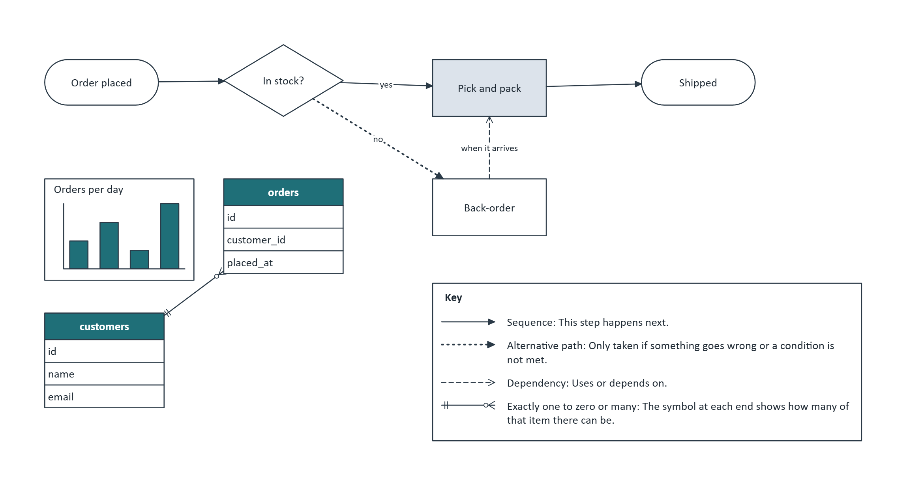

# The `.flow` language

A `.flow` file is the whole drawing as text: every page, shape, connection and key. It's what the editor saves,
what the text pane shows, and what the canvas is rebuilt from on every change. This page describes all of it, then
how the text pane helps you write it.

## An example

```
flow 1
page "Orders" size 304x163 direction LR

# A small example of the .flow language, used in docs/flow-language.md.
# Comments start with # at the start of a line or after a space.

start: terminator "Order placed" @ 15,20
check: decision "In stock?" @ 75,15 40x24
pick: process "Pick and pack" @ 145,20 [fill=#DCE3EB]
wait: process "Back-order" @ 145,60
ship: terminator "Shipped" @ 215,20
sales: bar "Orders per day" { 3, 5, 2, 7 } @ 15,60 50x34
orders: table "orders" { id; customer_id; placed_at } @ 75,60 40x30
customers: table "customers" { id; name; email } @ 15,105 40x30

start -> check
check -> pick : "yes"
check -alt-> wait [weight=1.5] : "no"
wait ..> pick : "when it arrives"
pick -> ship
customers ||--o{ orders

key "Key" @ 145,95
```

draws this ([source](diagrams/language-example.flow)):



## How a file is laid out

One statement per line. Blank lines are ignored, and so is anything after a comment mark.

| Statement  | Looks like                                    | Where                                                                                                |
|------------|-----------------------------------------------|------------------------------------------------------------------------------------------------------|
| Header     | `flow 1`                                      | The first line. Optional, but if it's there it must come before any page, and the version must be 1. |
| Icon       | `icon server "data:image/svg+xml;base64,..."` | Under the header, before the pages. A picture that shapes can use.                                   |
| Page       | `page "Orders" size 297x210 direction LR`     | Starts a page. Everything after it, up to the next page, is on it.                                   |
| Shape      | `pick: process "Pick and pack" @ 145,20`      | On a page.                                                                                           |
| Connection | `pick -> ship : "next"`                       | On a page.                                                                                           |
| Key        | `key "Key" @ 145,95`                          | On a page; at most one per page.                                                                     |

A file with no `page` line still works: everything goes on one page, called `Page-1`.

### The small print

- **Comments.** `#` starts a comment at the start of a line or after a space, and it runs to the end of the line.
  A `#` inside quotes, or straight after `=` as in `fill=#1F6F78`, is not a comment.
- **Ids** name shapes: a letter or `_`, then letters, digits, `_` or `-` (`order_2`, `pick-and-pack`). An id is
  unique on its page; different pages can reuse it.
- **Text in quotes** can hold `\"` for a quote, `\\` for a backslash and `\n` for a new line:
  `"Delete this file?\nThis can't be undone."`.
- **Keywords and type names** don't care about case: `Page`, `PROCESS` and `Direction lr` all work. Ids do care.
- **Units.** Positions and sizes are in millimetres, measured from the top left of the page. Text sizes and line
  weights are in points. Colours are `#` and six hex digits.

## Pages

```
page "Name" size WxH direction LR
```

| Part        | Meaning                                                                                                                                                                                                                                                                       |
|-------------|-------------------------------------------------------------------------------------------------------------------------------------------------------------------------------------------------------------------------------------------------------------------------------|
| `"Name"`    | Required. Shown on the page's tab.                                                                                                                                                                                                                                            |
| `size WxH`  | Optional. The page size in mm, each side 50 to 5000 (`297x210` is A4 landscape). Without it, the page grows with whatever is on it, from A4 landscape up. With it, the page stays that size, and anything past the edge is shown on grey and left out of PNG and PDF exports. |
| `direction` | Optional. Which way shapes without a position are laid out: `TB` (top to bottom, the default; `TD` means the same), `LR`, `BT` or `RL`.                                                                                                                                       |

## Shapes

```
id: type "label" { list } @ x,y WxH [settings]
```

Only `id: type` is required. The other parts can come in any order.

| Part             | Meaning                                                                                                                                                                                                                                                                                                                                                                                                                                  |
|------------------|------------------------------------------------------------------------------------------------------------------------------------------------------------------------------------------------------------------------------------------------------------------------------------------------------------------------------------------------------------------------------------------------------------------------------------------|
| `type`           | What kind of shape: `process`, `decision`, `table`, `bar`, `button`, ... Every type is pictured in the README's [Shapes](../README.md#shapes) section, with the name to type under it. The aliases below work too.                                                                                                                                                                                                                       |
| `"label"`        | The shape's text. Without one, the shape has none. (Shapes added from the palette start with sample text, like `"Button"` or `"40%"`, and that's written here as their label.)                                                                                                                                                                                                                                                           |
| `{ list }`       | Only for these three: a **table**'s columns, separated by `;` or `,`: `{ id; name; email }`. A **grid**'s cells, rows separated by `;` and cells by `,`, with `""` for an empty cell: `{ Name, Email; Ann, ann@example.com }`. A **chart**'s values: `{ 3, 5, 2, 7 }`, or a row per series for bar, line, area, radar, stacked and 100% charts: `{ 3, 5, 2; 4, 1, 6 }` (see the README for the charts that take pairs, threes or fours). |
| `@ x,y`          | Where the shape's top-left corner goes, in mm. Without it, the shape is placed automatically, following the page's direction.                                                                                                                                                                                                                                                                                                            |
| `WxH`            | After the position: its width and height in mm (2 to 2000). Without it, the shape is sized to fit its text. Tables and grids take their height from their rows.                                                                                                                                                                                                                                                                          |
| `WxH` on its own | A size with no position: placed automatically, at that size, like `40x20`.                                                                                                                                                                                                                                                                                                                                                               |
| `[settings]`     | Its look; see below.                                                                                                                                                                                                                                                                                                                                                                                                                     |

### Shape settings

Written inside `[ ]`, separated by spaces: `[fill=#DCE3EB stroke=#2B3A47 weight=1.5]`.

| Setting   | Values                                                                                                | Meaning                                                                                                                                                                                                                                                              |
|-----------|-------------------------------------------------------------------------------------------------------|----------------------------------------------------------------------------------------------------------------------------------------------------------------------------------------------------------------------------------------------------------------------|
| `fill`    | a colour, like `#DCE3EB`                                                                              | Fill colour.                                                                                                                                                                                                                                                         |
| `stroke`  | a colour                                                                                              | Line colour.                                                                                                                                                                                                                                                         |
| `text`    | a colour                                                                                              | Text colour.                                                                                                                                                                                                                                                         |
| `weight`  | 0.25 to 12                                                                                            | Line thickness, in points.                                                                                                                                                                                                                                           |
| `size`    | 4 to 96                                                                                               | Text size, in points.                                                                                                                                                                                                                                                |
| `icon`    | an icon's name                                                                                        | Draw the shape with that picture (see Icons).                                                                                                                                                                                                                        |
| `state`   | `on` or `off`                                                                                         | Only for switches, checkboxes and radio buttons: on ticks, selects or switches it on. Off is the default, so it's never written.                                                                                                                                     |
| `side`    | `left` or `right`                                                                                     | Only for chat bubbles: right is a message from me, the bubble and its avatar mirrored to the right. Left is the default, so it's never written.                                                                                                                      |
| `map`     | `uk` or `france`; `yorkshire`, `lancashire`, `greatermanchester`, `merseyside`, `cheshire`, `cumbria` | Only for country maps (which country: the UK, the default, or France's departments) and route maps (which area: Yorkshire's four parts, the default, or a North West county's council districts). The default is never written.                                      |
| `face`    | `happy`, `sad`, `mad`, `angry` or `laughing`                                                          | Only moods: which face it pulls, and the shade to match. Happy is the default, so it's never written. `smile` and `:)` mean happy, `frown` and `:(` sad, `cross` mad, `furious` and `>:(` angry, `laugh`, `:D` and `lol` laughing. The label never changes the face. |
| `colours` | colours, like `#AA3377,#228833`                                                                       | Only charts and legends: a colour per series, in order, the first replacing the fill. Series past the list take the built-in colours. Commas with no spaces, or quoted with spaces: `colours="#AA3377 #228833"` (a `#` after a space starts a comment).              |
| `in`      | a container's id                                                                                      | The container, pool or lane the shape is inside (see Containers).                                                                                                                                                                                                    |
| `flow`    | `row` or `column`                                                                                     | Only containers: line up what's in it, in the order of its lines (see Flexi containers).                                                                                                                                                                             |
| `gap`     | 0 to 200                                                                                              | With `flow`: the space between the shapes, in mm. 4 if left out.                                                                                                                                                                                                     |
| `align`   | `start`, `center`, `end`, `stretch`                                                                   | With `flow`: how the shapes sit across it. `stretch` (the default) makes them as wide as a column, or as tall as a row.                                                                                                                                              |
| `scroll`  | 0 to 10000                                                                                            | A scroll area: how far it's scrolled along its bar, in mm. 0 (the start) if left out.                                                                                                                                                                                |

### Containers

A `container` is a labelled frame, and a `pool` or `lane` is one with its label down the left (swimlanes). A shape
goes inside one with `in`, naming it by id. Each shape keeps its own line, so moving a shape from one container to
another changes only that line:

```
board: container "Sprint 12"
plan: process "Plan" [in=board]
build: process "Build" [in=board]
orders: pool "Orders"
cust: lane "Customer" [in=orders]
shop: lane "Shop" [in=orders]
order: process "Place order" [in=cust]
```

- Containers can be inside containers (lanes inside a pool, boxes inside a lane).
- A container with no `@` is placed with its members laid out inside it. Without a `WxH` it's made big enough to
  hold them, and with no `@` of its own it goes round any members that have one.
- A pool stacks lanes that have no place of their own, one under the other, each as wide as the pool.
- On the page, moving a container moves what's in it, dropping a shape on a container puts it inside (the container
  grows to fit), and dragging it off takes it out. Once anything in a container is moved, the container and
  everything in it is given its place, so the next layout keeps them together.
- Deleting a container leaves its members where they are, no longer inside anything.
- `in` must name a container on the same page, and two containers can't each be inside the other.

### Flexi containers

A container with `flow` lines up what's in it itself, like a flexbox: `flow=row` side by side, `flow=column` one
under another, in the order of their lines, `gap` mm apart:

```
board: container "Sprint 12" [flow=row gap=6]
todo: container "To do" [flow=column in=board]
done: container "Done" [flow=column in=board]
c1: process "Password reset" [in=todo]
c2: process "Login page" 40x20 [in=done]
```

- Its members have no position. On the page, dragging one to a new spot reorders their lines, and a shape dropped in
  from elsewhere has its line moved next to its new neighbours.
- A member can have a size of its own, written `WxH` with no `@`. Any shape can be written that way: placed
  automatically, at that size. A member's `@ x,y` is read as just its size, and left as typed.
- `align=stretch` (the default) stretches members that have no size of their own; tables and grids keep their height.
- Without a `WxH`, a flexi container fits round its members. With one, members that don't fit stick out past its end.

### Scroll areas

A `scroll` (also written `scrollarea`, `scrollpane`, `scrollview`) is a container that keeps its size, as its `WxH`
gives it or its default, and cuts off whatever doesn't fit inside it. Its scrollbar runs down the right, or along the
bottom with `flow=row`, and the thumb's length shows how much of what's in it fits. With `flow`, it lines its members
up too, so a scrolling list is:

```
results: scroll "Search results" @ 15,15 80x70 [flow=column gap=3]
r1: process "Flow editor: diagrams as text" [in=results]
r2: process "Swimlanes in five minutes" [in=results]
```

`scroll=40` shows it scrolled 40 mm along, its contents moved back that far and the thumb moved to match; the
properties panel's Scrolled box sets it too. Past the end, the last of what's in it stops at the end, though the text
keeps what you typed. A shape with a place (`@ x,y`) inside a scrolled area keeps that place in the text: it's where
the shape would be unscrolled.

What's cut off is still there: it's in the text, and exports to other formats (Visio, draw.io, Mermaid...) show it
all. Pictures (PNG, PDF) are cut off as on the page.

### Mind maps

A `centraltopic` (also `mindmap`, `centralidea`) starts a mind map. The `topic` lines (also `branch`, `subtopic`) that
come after it, up to the next central topic, are its topics, and indenting a topic's line hangs it off the topic above
it that's indented less; one that isn't indented hangs off the central topic. Each gets a branch line, with no
connection to write:

```
idea: centraltopic "New website" @ 20,20
goals: topic "Goals"
  signups: topic "More sign-ups"
  speed: topic "Faster pages"
users: topic "Users"
```

The map lays its topics out on both sides of the central topic, so only the central topic takes a place: move it and
the map moves with it; delete a topic and its branch goes too, or delete the central topic and the whole map goes. A
topic's own `WxH` is kept as its size. A topic with an `@ x,y` isn't in the map and stands on
its own. On the page, **Add topic** in the properties panel adds a topic under the selected central topic or topic and
writes its line for you. In the text pane, Tab indents by two spaces; any amount of indent works, as long as a topic's
children are
indented more than it is. A map can also be written with connections between its shapes, `idea -> goals`, as before;
those topics keep their connections instead of branch lines.

### Sequence diagrams

The first `lifeline` (also `participant`) on a page that isn't in a container starts a sequence diagram, and every
later lifeline with no `@` and no `[in=]` joins it. The connections between two of its lifelines are its messages:

```
client: lifeline "Client"
server: lifeline "Server"
db: lifeline "Database"
client -> server : "GET /orders"
server -> db : "query"
db ..> server : "rows"
server ..> client : "200 OK"
```

The lifelines stand side by side in text order, tops level, and each message is a level arrow from one dashed line to
the other, one under another in the order of their lines. The lifelines are made as long as the messages need. None
of this is written into the text: only the first lifeline takes a place, and moving it moves the sequence. A later
lifeline with an `@` stands on its own, and a message with its own `beginpt`, `endpt` or `route=elbow` is drawn as
those say. A connection from a lifeline to itself isn't drawn yet (no shape's connection to itself is), though it
stays in the text.

### Type aliases

Other names you can type for a shape type. They're read as the type they stand for, and saved as that type.

| Type                | Also written as                          |
|---------------------|------------------------------------------|
| `process`           | `rect`, `box`, `step`                    |
| `decision`          | `diamond`                                |
| `terminator`        | `start`, `end`, `stadium`                |
| `database`          | `db`, `cylinder`                         |
| `document`          | `doc`                                    |
| `multidoc`          | `docs`                                   |
| `user`              | `person`, `actor`                        |
| `api`               | `component`, `system`                    |
| `preparation`       | `hexagon`                                |
| `ellipse`           | `circle`                                 |
| `text`              | `label`, `note`                          |
| `mobile`            | `screen`                                 |
| `tablet`            | `tabletscreen`                           |
| `smartwatch`        | `watch`, `wearable`                      |
| `appwindow`         | `window`, `desktopwindow`                |
| `field`             | `input`                                  |
| `dropdown`          | `select`                                 |
| `radio`             | `radiobutton`, `option`                  |
| `progress`          | `ring`, `radial`, `gauge`                |
| `progressbar`       | `meter`                                  |
| `switch`            | `toggle`                                 |
| `slider`            | `range`                                  |
| `search`            | `searchbox`                              |
| `password`          | `passwordfield`                          |
| `numberinput`       | `number`, `spinbox`                      |
| `segmented`         | `buttongroup`                            |
| `timepicker`        | `time`                                   |
| `colourpicker`      | `colorpicker`, `swatch`                  |
| `upload`            | `dropzone`, `fileupload`                 |
| `otp`               | `pincode`, `codeinput`                   |
| `togglechips`       | `choicechips`                            |
| `rangeslider`       | `dualslider`                             |
| `formfield`         | `labelledfield`                          |
| `textarea`          | `multiline`                              |
| `datepicker`        | `date`, `calendar`                       |
| `navbar`            | `header`, `topbar`                       |
| `modal`             | `dialog`                                 |
| `alert`             | `banner`                                 |
| `tooltip`           | `hint`                                   |
| `spinner`           | `loader`, `loading`                      |
| `skeleton`          | `placeholder`                            |
| `toast`             | `snackbar`                               |
| `emptystate`        | `empty`, `nodata`                        |
| `inlineerror`       | `fielderror`, `errortext`                |
| `dropdownmenu`      | `openmenu`, `droplist`                   |
| `contextmenu`       | `rightclick`, `popupmenu`                |
| `menubar`           | `menus`                                  |
| `tabbar`            | `bottomnav`, `bottomtabs`                |
| `fab`               | `floatingbutton`, `actionbutton`         |
| `backheader`        | `appbar`, `backbar`                      |
| `divider`           | `separator`, `rule`, `hr`                |
| `footer`            | `pagefooter`                             |
| `hero`              | `herosection`, `jumbotron`               |
| `splitpane`         | `splitview`                              |
| `scrollbar`         | `scrolltrack`                            |
| `carousel`          | `slideshow`, `imagecarousel`             |
| `codeblock`         | `code`, `snippet`                        |
| `chatbubble`        | `chat`, `chatmessage`                    |
| `commentthread`     | `comments`, `thread`                     |
| `bell`              | `notificationbell`, `notifications`      |
| `usermenu`          | `accountmenu`, `profilemenu`             |
| `mapview`           | `streetmap`, `mapwidget`                 |
| `satellite`         | `aerial`, `satelliteview`                |
| `streetview`        | `streetlevel`                            |
| `mappin`            | `locationpin`, `mapmarker`               |
| `directions`        | `routepanel`, `routesteps`               |
| `captcha`           | `robotcheck`, `notarobot`                |
| `imagecaptcha`      | `tilecaptcha`, `picturecheck`            |
| `textcaptcha`       | `codecaptcha`                            |
| `avatar`            | `profile`                                |
| `badge`             | `chip`, `tag`, `pill`                    |
| `rating`            | `stars`                                  |
| `glyph`             | `iconholder`, `symbol`                   |
| `breadcrumb`        | `crumbs`                                 |
| `pagination`        | `pager`                                  |
| `stepper`           | `steps`, `wizard`                        |
| `pills`             | `chips`, `filters`, `slicer`             |
| `sidebar`           | `sidemenu`, `sidenav`                    |
| `list`              | `bullets`                                |
| `image`             | `picture`, `img`                         |
| `bar`               | `column`, `barchart`, `clustered`        |
| `hbar`              | `hbarchart`                              |
| `stackedbar`        | `stackedcolumn`                          |
| `percentbar`        | `percentcolumn`                          |
| `line`              | `linechart`                              |
| `area`              | `areachart`                              |
| `pie`               | `piechart`                               |
| `radar`             | `spider`, `radarchart`                   |
| `polar`             | `rose`, `nightingale`                    |
| `candlestick`       | `ohlc`, `candles`                        |
| `boxplot`           | `boxwhisker`, `whisker`                  |
| `gantt`             | `ganttchart`, `schedule`                 |
| `legendrow`         | `rowlegend`, `hlegend`                   |
| `treemap`           | `tiles`                                  |
| `wordcloud`         | `tagcloud`, `wordle`                     |
| `sankey`            | `alluvial`, `flows`                      |
| `chord`             | `chorddiagram`                           |
| `tilemap`           | `choropleth`, `regionmap`                |
| `worldmap`          | `geomap`, `world`                        |
| `routemap`          | `roads`                                  |
| `heatmap`           | `heatgrid`                               |
| `sparkline`         | `spark`                                  |
| `dial`              | `speedometer`                            |
| `donut`             | `doughnut`                               |
| `kpi`               | `card`, `metric`                         |
| `container`         | `frame`, `boundary`, `section`           |
| `lane`              | `swimlane`                               |
| `scroll`            | `scrollarea`, `scrollpane`, `scrollview` |
| `c4boundary`        | `systemboundary`                         |
| `sticky`            | `stickynote`, `postit`                   |
| `callout`           | `speechbubble`                           |
| `personcard`        | `orgcard`, `employee`                    |
| `centraltopic`      | `mindmap`, `centralidea`                 |
| `topic`             | `branch`, `subtopic`                     |
| `timeline`          | `timescale`                              |
| `phases`            | `roadmap`, `chevrons`                    |
| `mood`              | `feeling`, `emotion`                     |
| `umlclass`          | `class`, `classbox`                      |
| `state`             | `umlstate`                               |
| `initial`           | `startstate`, `initialstate`             |
| `final`             | `endstate`, `finalstate`                 |
| `lifeline`          | `participant`                            |
| `activation`        | `activationbar`                          |
| `startevent`        | `bpmnstart`                              |
| `endevent`          | `bpmnend`                                |
| `timerevent`        | `timer`                                  |
| `messageevent`      | `message`                                |
| `gateway`           | `xorgateway`, `exclusivegateway`         |
| `parallelgateway`   | `andgateway`                             |
| `task`              | `activity`, `bpmntask`                   |
| `usertask`          | `manualtask`                             |
| `servicetask`       | `automatedtask`                          |
| `dataobject`        | `dataobj`                                |
| `intermediateevent` | `intermediate`, `boundaryevent`          |
| `inclusivegateway`  | `orgateway`                              |
| `eventgateway`      | `eventbasedgateway`                      |
| `bpmnsubprocess`    | `collapsedsubprocess`, `callactivity`    |
| `c4system`          | `c4softwaresystem`, `softwaresystem`     |
| `c4external`        | `c4externalsystem`, `externalsystem`     |
| `firewall`          | `wall`                                   |
| `loadbalancer`      | `loadbalance`, `lb`                      |
| `queue`             | `messagequeue`, `mq`                     |
| `bucket`            | `storage`, `blob`                        |
| `phone`             | `smartphone`, `mobiledevice`             |
| `service`           | `microservice`                           |

## Connections

```
from TYPE to [settings] : "label"
```

`from` and `to` are shape ids on the same page, and `TYPE` is the connection type between them. The settings must
come before the label. The quotes around the label are optional: everything after the colon is the label.

If a connection names an id that no shape has, that shape is made for you: a `process` with the id as its text.
`a -> b -> c` is not allowed. Each connection is its own line.

### Connection types

| Type             | Write                        | Line and ends                         | Means (shown in the key)                                      |
|------------------|------------------------------|---------------------------------------|---------------------------------------------------------------|
| Sequence         | `->`                         | solid, arrow                          | This step happens next.                                       |
| Data flow        | `-data->`                    | dashed, arrow                         | Information passes from one to the other.                     |
| Message          | `-msg->`                     | dashed, circle to hollow triangle     | One notifies the other, often across teams or systems.        |
| Alternative path | `-alt->`                     | dotted, arrow                         | Only taken if something goes wrong or a condition is not met. |
| Two-way          | `<->`                        | solid, arrows at both ends            | Exchange or sync in both directions.                          |
| Annotation       | `..`                         | dotted, no ends                       | Related to, or see note. No flow is implied.                  |
| Dependency       | `..>`                        | dashed, open arrow                    | Uses or depends on.                                           |
| Association      | `--`                         | solid, no ends                        | Connected to.                                                 |
| Generalisation   | `--\|>`                      | solid, hollow triangle                | Is a type of.                                                 |
| Realisation      | `..\|>`                      | dashed, hollow triangle               | Implements.                                                   |
| Aggregation      | `o--`                        | solid, hollow diamond at the start    | Has; the part can exist on its own.                           |
| Composition      | `*--`                        | solid, filled diamond at the start    | Owns; the part cannot exist without it.                       |
| Crow's foot      | `\|\|--o{` and others, below | solid or dashed, how many at each end | Each `from` has ... `to`; each `to` belongs to ... `from`.    |

Every type is pictured in the README's
[Connection types, arrows and the key](../README.md#connection-types-arrows-and-the-key) section.

**Crow's foot.** Three parts: the start end, `--` (solid) or `..` (dashed), and the finish end.

| How many     | Start end | Finish end |
|--------------|-----------|------------|
| Exactly one  | `\|\|`    | `\|\|`     |
| Zero or one  | `\|o`     | `o\|`      |
| One or many  | `}\|`     | `\|{`      |
| Zero or many | `}o`      | `o{`       |

So `customers ||--o{ orders` is "each customer has zero or many orders; each order belongs to exactly one
customer", and `team }o..|{ member` is a dashed many-to-many.

### Connection settings

| Setting            | Values                                                                                                        | Meaning                                                                                                                                                      |
|--------------------|---------------------------------------------------------------------------------------------------------------|--------------------------------------------------------------------------------------------------------------------------------------------------------------|
| `style`            | `solid`, `dashed`, `dotted`                                                                                   | The line's pattern.                                                                                                                                          |
| `start`, `end`     | `none`, `arrow`, `open`, `triangle`, `diamond`, `fdiamond`, `circle`, `one`, `zeroOne`, `oneMany`, `zeroMany` | The line's ends. `arrow` is filled and `open` is an open arrow; `triangle` and `diamond` are hollow, `fdiamond` filled; the last four are crow's foot ends.  |
| `means`            | text in quotes                                                                                                | What the key says the line means, instead of the type's own meaning.                                                                                         |
| `stroke`           | a colour                                                                                                      | Line colour.                                                                                                                                                 |
| `text`             | a colour                                                                                                      | Label colour.                                                                                                                                                |
| `weight`           | 0.25 to 12                                                                                                    | Line thickness, in points.                                                                                                                                   |
| `size`             | 4 to 96                                                                                                       | Label text size, in points.                                                                                                                                  |
| `route`            | `straight`, `elbow`                                                                                           | A direct line, or right angles routed around shapes.                                                                                                         |
| `via`              | `"x,y x,y ..."`                                                                                               | An elbow line's bend points, in mm from the top left of the page.                                                                                            |
| `beginpt`, `endpt` | `n`, `e`, `s`, `w`, or a side and a point along it from 0 to 1: `e@0.3`                                       | Fix an end to the middle of that side of its shape (or that far along it: down for e and w, across for n and s), instead of letting it face the other shape. |

Setting `style`, `start` or `end` makes the line a custom one, which the key lists with its own meaning:
`a -- b [style=dashed start=circle end=fdiamond means="Escalates to"]`. When the editor writes the line back, it
picks the type that matches: `a -- b [style=solid start=none end=arrow]` becomes `a -> b`.

## The key

```
key "Title" @ x,y
```

Draws a key on the page: one row per connection type the page uses, each with a sample of its line and its
meaning. The title is optional (`Key` if left out), and so is the position (to the right of everything else if left
out). It keeps itself up to date as connections change, and dragging it writes its new position back here.

## Icons

```
icon name "data:image/svg+xml;base64,..."
```

A picture, defined once at the top of the file and used by any number of shapes with `[icon=name]`. It must be an
SVG, PNG or JPEG data URI, up to 2 million characters. Visio icons and pictures chosen for image shapes are kept
this way, so a drawing stays one file. Replacing a picture removes its icon line once nothing uses it.

## Animations

An `@animation` block, the last thing in the file, plays the drawing one step at a time, like a slide deck. Each
step restates shapes with `$id`, written like any shape line, and only what it writes changes:

```
order: process "Order" @ 20,20
pay: process "Pay" @ 80,20 [fill=#DE2121]
ship: process "Ship" @ 140,20
order -> pay
pay -> ship

@animation start
step 1
   $pay @ 80,60 [fill=#C8E6C9]      # Pay moves down and turns green
step 3
   $order terminator                # Order becomes a terminator; Pay stays green from step 1
   -$ship                           # Ship goes, and pay -> ship with it
step 4
   +retry: process "Retry" @ 140,60 # a shape only the animation has
   +$ship                           # Ship comes back as it was
@animation end
```

| Line             | What it does                                                                                                                                           |
|------------------|--------------------------------------------------------------------------------------------------------------------------------------------------------|
| `step N`         | Starts a step. The numbers are an order, and gaps are skipped: the steps above are three clicks, 1, 3 and 4.                                           |
| `$id [type] ...` | Changes a shape that already exists. After the id comes anything a shape line can have: a new type, a label, `@ x,y`, `WxH`, `[settings]`, `{ }`.      |
| `+id: type ...`  | Adds a shape that only the animation has: a whole shape line, with an id no other shape uses.                                                          |
| `-$id`           | Hides a shape (from the drawing or added by a step). Its connections hide with it, and so do a container's members and the topics down a map's branch. |
| `+$id`           | Shows a hidden shape again, with the values it had when it was hidden.                                                                                 |

**What carries over.** Anything a `$id` line leaves out stays as the step before had it (or as the drawing has it),
and a change stays until a later step changes it again. `$box @ 120,50` moves a shape and keeps its size;
`$box 90x60` resizes it where it is. Writing a setting at its default counts: `$sw [state=off]` turns a switch off.

**Changing type.** A `$id` line can give a shape a new type, as long as the result would be a valid shape line for
that type. A setting written on the step line that the new type can't have is an error. One carried over from
before is left out, with a note: a chat bubble's `side=right` is dropped when it becomes a process.

**Pages.** `$id` finds its shape on any page, so an id used on more than one page is an error in a step. A shape
added with `+id:` goes in the page of its `[in=]` container, or else the page of the first shape its step names, or
else the first page. Presenting follows the steps from page to page.

**Presenting.** **Present** in the toolbar plays the steps full screen, from the drawing as it is. Next is **→**,
**Space**, **Page Down** or a click; back is **←**, **Backspace** or **Page Up**. **Home** and **End** jump to the
start and the last step, the bar at the bottom picks any step, and **Esc** leaves. A shape that moves or changes size
slides there, one that changes how it looks crossfades as it moves, and shapes and connections that appear or go
fade in or out (not with your system's reduced motion setting). Shapes the layout places keep the places they have in
the drawing, so a step that moves one shape leaves the rest where they were.

**The drawing stays the drawing.** Nothing can be edited while presenting, and leaving shows exactly the drawing
again: nothing added, hidden or changed by a step remains. Editing the drawing never touches the block, and the
editor keeps it last (adding a page puts the page above it). Renaming a shape renames its `$id` lines too. Exports
leave the block out: PNG, PDF, Visio, Mermaid and the others all show the drawing as it is without any step.

What the checker reports in the block:

- `There is no shape "x" for $x.`
- `Nothing can come after @animation end: the animation block is the last thing in the file.`
- `Step lines only go inside an @animation block: ...` (a `$`, `+` or `step` line outside it)
- A setting written on a step line that the shape's type can't have, with the usual message (
  `Only chat bubbles have a side.`)
- `"x" is already a shape, so +x: can't make a new one. Use $x to change it.`
- `"x" is hidden at this step, so $x can't change it. Show it again first with +$x.` (and `-$x` on a hidden shape)
- `+$x shows a hidden shape, but "x" isn't hidden at this step.`
- `"x" only exists in the animation (+x), so a connection outside it can't use it.`
- A warning, `"x" comes up again later in step N, so only that later line counts.`, for a shape twice in one step
- A note when changing type leaves out a carried-over setting

Warnings and notes are marked in the margin in amber; they don't stop the text being applied.

## Mistakes

A line the editor can't read is marked in the text pane's margin, and the bar under the text says what's wrong with
the first one, like:

-

`Line 9: Unknown shape type "proces". Try: process, decision, terminator, data, subprocess, document, multidoc, manualInput…`
-
`Line 18: "->>" is not a connection. Try -> for a sequence, -data-> for data flow, ..> for a dependency or ||--o{ for one to many.`

- `Line 12: fill needs a colour like #1F6F78.`
- `Line 20: Unexpected "[bad]" after the connection.` (the settings came after the label)
- `Line 7: There is no container "lane3" on this page.` (the shape is still drawn, just not inside anything)

While you're typing, the page waits until **all** of the text reads cleanly, and redraws about a third of a second
after you stop. Until then it keeps showing the last good version, so a half-typed line never breaks the drawing.
When you open a file with mistakes, the lines that read are drawn, and a message says how many could not be.

## Writing it in the text pane

Open the text pane with **Text** on the edge of the page, or **Ctrl+E**. **Pin** keeps it open beside the
page; unpinned, it closes when you click the page.

- **It works both ways.** Typing redraws the page, and editing the page rewrites only the lines that changed, so
  your comments, blank lines and order stay put.
- **The selection follows you.** Putting the caret on a line selects that shape, connection or key on the page.
  Selecting something on the page highlights its line and scrolls to it.
- **Undo** treats a burst of typing (keys less than a second and a half apart) as one step, shared with the
  page's undo.
- **Tab** puts in two spaces.
- **Other languages.** The box at the top shows the page as Mermaid, PlantUML, a PlantUML activity diagram or
  Graphviz DOT instead. Those aren't live: edit, then **Apply** (or **Revert**). Shapes whose names still match
  keep their places.

### IntelliSense

As you type, a list pops up under the caret with what can come next. It knows where you are in the line:

| You've typed              | It suggests                                                                                                                                                                                                |
|---------------------------|------------------------------------------------------------------------------------------------------------------------------------------------------------------------------------------------------------|
| The start of a line       | `page`, `key` and `icon`, and the ids of the shapes on this page, to start a connection from                                                                                                               |
| `id:`                     | Every shape type, with its palette name (`process — Process`), and every alias (`ring — Same as progress`)                                                                                                 |
| `id ` (an id and a space) | Every connection type with its meaning, plus three crow's foot ones: `\|\|--o{`, `\|\|--\|\|`, `}o--o{`                                                                                                    |
| `id -> `                  | The ids of the shapes on this page, with their text                                                                                                                                                        |
| `[` on a shape line       | The shape settings that line doesn't have yet: `fill=`, `stroke=`, `text=`, `weight=`, `size=`, `icon=`, `state=`, `side=`, `colours=`, `flow=`, `gap=`, `align=`, `in=` (then the containers on the page) |
| `[` on a connection line  | The connection settings: `style=`, `start=`, `end=`, `stroke=`, `weight=`, `size=`, `text=`, `means=`, `route=`, `via=`                                                                                    |
| `setting=`                | Its values: the Routes colour palette for colours, common sizes and weights in points, line patterns and ends, `straight`/`elbow`, `on`/`off`, and the icons defined in this file                          |
| `page "Name" `            | `size ` and `direction `; then A4, A3, A2 and A1 sizes, or the four directions                                                                                                                             |


**How it chooses.** It filters on the word you're typing: matches that *start* with it first, then ones that
*contain* it (`pro` finds `process`, then `subprocess`). It shows up to 50, and closes when nothing matches, or when
the only match is what you've already typed.

**Keys.** **Up**/**Down** move through the list and **Page Up**/**Page Down** jump eight. **Enter** or **Tab**
accepts and **Escape** closes. **Ctrl+Space** opens it anywhere, even before you've typed anything. Moving the
caret with the mouse or the arrow keys closes it.

**Accepting does a little more than insert the word:**

- A shape type adds `""` and puts the caret between the quotes, ready for the label.
- A connection type adds a space and opens the list of shapes to connect to.
- A setting adds `=` and opens the list of its values.

**It stays quiet** inside quoted text and comments, and in the other languages. Two things it doesn't suggest yet:
`beginpt=`/`endpt=` on connections, and a key's `@`.

## Grammar, in short

```
file        = [ "flow 1" ] { icon } { page-block } [ animation ]
icon        = "icon" name "\"data:image/...;base64,...\""
page-block  = [ "page" "\"name\"" [ "size" W "x" H ] [ "direction" (TB|TD|LR|BT|RL) ] ] { shape | connection | key }
shape       = id ":" type { "\"label\"" | "{" list "}" | "@" x "," y [ W "x" H ] | W "x" H | "[" settings "]" }
connection  = id TYPE id [ "[" settings "]" ] [ ":" ( "\"label\"" | text ) ]
key         = "key" [ "\"title\"" ] [ "@" x "," y ]
settings    = { name "=" ( value | "\"text\"" ) }
comment     = "#" ... to the end of the line, at the start of a line or after a space
animation   = "@animation start" { "step" N { change } } "@animation end"
change      = "$" id [ type ] { shape part } | "+" id ":" type { shape part } | "-$" id | "+$" id
```
